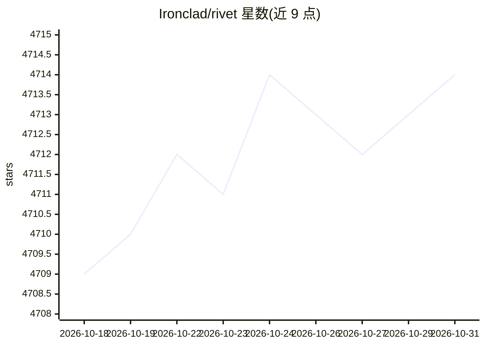

# Ironclad/rivet

⭐ 4,714 · TypeScript · MIT · 推送 2026-08-26 · [GitHub](https://github.com/Ironclad/rivet) · [官网](https://rivet.ironcladapp.com) · 组织维护

**可视化 AI 编程环境：用图形构建 AI agent 与提示链并嵌入应用**

包含两部分：一是桌面应用 Rivet，用于以节点图方式创建复杂 AI agent 与提示链（prompt chaining），支持 OpenAI GPT-3.5/GPT-4、Anthropic Claude 各系列模型，以及 OpenAI Embeddings、Pinecone 向量库和 AssemblyAI 语音转文字集成；二是 TypeScript 库 Rivet Core（NPM 发布为 @ironclad/rivet-core 与 @ironclad/rivet-node），可在自有应用中运行 Rivet 图并双向调用。提供 macOS/Linux/Windows 预编译安装包，也可从源码构建。

## 筛选速览

| 维度 | 判定 | 备注 |
|---|---|---|
| AI 角色 | `ai-ecosystem` | LLM/agent 周边工具 |
| 许可风险 | `permissive` | MIT |
| 部署形态 | `desktop` | 安装包/桌面程序 |
| 模型依赖 | locked-api |  |
| 硬件要求 | — | 无带数字的原话,不猜 |
| 安装摩擦 | `low` | 无编译、无系统依赖或容器化 |
| 成熟度 | — | 结构信号不足 |

## 能力要点

- 节点图方式构建 AI agent 与提示链的桌面应用
- 支持 OpenAI GPT-3.5/GPT-4 与 Anthropic Claude 系列模型
- 嵌入/向量库支持：OpenAI Embeddings、Pinecone
- Rivet Core TypeScript 库可将图嵌入自有应用运行

## 适用场景

- 用可视化画布编排多步 LLM 提示链与 agent
- 把在 Rivet 中构建的图嵌入自己的应用运行
- 结合向量数据库与语音转文字搭建多模态工作流

## 场景标签

`Agent 框架` · 领域:Agent 开发

## 证据(README 行号)

> L27: Rivet is a desktop application for creating complex AI agents and prompt chaining, and embedding it in your applica
> L49: Rivet core is a TypeScript library for running graphs created in Rivet. It is used by the Rivet application, but ca

## 星数曲线

2026-10-18 4,709 → 2026-10-31 4,714（+5）

---
*卡片 v1 · prompt 1.4 · 生成 2026-10-20 · 置信度 high · 依据 README sha `7432a5b49209` · [字段定义](../../DATASET.md)*
