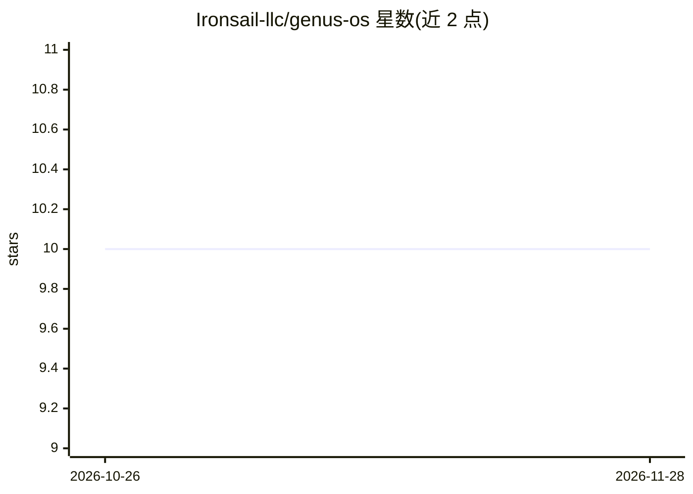

# Ironsail-llc/genus-os

⭐ 10 · Python · MIT · 推送 2026-11-27 · [GitHub](https://github.com/Ironsail-llc/genus-os) · 组织维护

**自托管的 AI agent 运行平台：企业可自有基础设施部署**

面向需要掌控运行时、数据流与部署生命周期的组织，提供可自托管（本地/私有云/气隙环境）的 agent 操作平台。Agent 以 YAML 声明式定义，接入带审计与 12 类 guardrail 策略的受治理管线；核心为小型确定性引擎，技能、工具、消息通道与连接器均以插件方式挂载。提供双层记忆（HNSW 向量 + BM25 混合检索）、本地化嵌入与生成选项、Ed25519 签名的多实例联邦、Next.js 控制台、内置多租户 CRM、桌面/浏览器自动化，以及 YOLOv8 + ArcFace 的本地视觉能力。MIT 许可，提供 systemd/Helm 部署文档。

## 筛选速览

| 维度 | 判定 | 备注 |
|---|---|---|
| AI 角色 | `ai-ecosystem` | LLM/agent 周边工具 |
| 许可风险 | `permissive` | MIT |
| 部署形态 | `self-host` | docker 或自建部署 |
| 模型依赖 | local-ok | 支持本地模型 |
| 硬件要求 | — | 无带数字的原话,不猜 |
| 安装摩擦 | `low` | 无编译、无系统依赖或容器化 |
| 成熟度 | `idea` | |

## 能力要点

- YAML 声明式 agent 清单与 per-agent 工具 allow/deny 列表
- 12 类 guardrail 策略，其中 3 条基线策略默认生效
- Ed25519 签名邀请令牌的三通道联邦同步（NATS JetStream）
- HNSW 向量 + BM25 融合的双层记忆，可选择全本地化模型

## 适用场景

- 在自有基础设施上运行企业内部 agent 平台
- 跨站点/子公司以密码学信任方式联邦多个实例
- 需要本地模型部署以保持数据不出域的场景
- 为 agent 工作流配置审批边界与审计证据

## 场景标签

`Agent 框架` `浏览器自动化` · 领域:Agent 开发

## 证据(README 行号)

> L20: Genus OS is a self-hosted agent operating platform for organizations that need
> L42: **Everything Is a Plugin** — The core is a small deterministic engine; everything
> L75: **Operations & CRM** — Built-in CRM with cross-channel identity resolution and multi-tenancy. Task state machine (T

## 星数曲线

2026-10-26 10 → 2026-11-28 10（+0）

---
*卡片 v1 · prompt 1.4 · 生成 2026-11-20 · 置信度 high · 依据 README sha `1f262b4debdb` · [字段定义](../../DATASET.md)*
