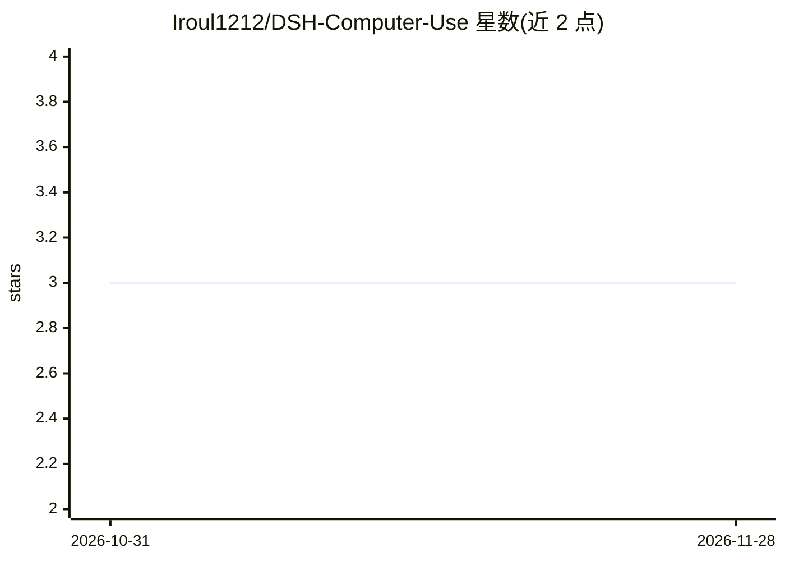

# Iroul1212/DSH-Computer-Use

⭐ 3 · JavaScript · MIT · 推送 2026-10-29 · [GitHub](https://github.com/Iroul1212/DSH-Computer-Use) · 个人维护 · 中文 README

**给 DSH agent 增加 Windows 桌面控制能力的插件包**

面向 DeepSeek Harness（DSH）的插件包，注册 5 个模型可调用工具（computer/app_window/ui_element/clipboard/app_skill，共 38 个 action），让 agent 在 Windows 上截图、操作鼠标键盘、管理窗口、按 UIA 无障碍路径定位控件并读取剪贴板。截图经附件管线传递并压缩到 60 万像素以内以匹配 DeepSeek 请求预算；提供点击穿透荧光 overlay、全局 Esc 急停、dryRun、审批路由与目标黑名单等安全机制。仅支持 Windows 10/11，依赖 Node ≥20 与 PowerShell。

## 筛选速览

| 维度 | 判定 | 备注 |
|---|---|---|
| AI 角色 | `ai-ecosystem` | LLM/agent 周边工具 |
| 许可风险 | `permissive` | MIT |
| 部署形态 | `desktop` | 安装包/桌面程序 |
| 模型依赖 | — | README 未给出锁定关系 |
| 硬件要求 | — | 无带数字的原话,不猜 |
| 安装摩擦 | `low` | 无编译、无系统依赖或容器化 |
| 成熟度 | — | 结构信号不足 |

## 能力要点

- 5 个工具、38 个 action，覆盖截图/键鼠/窗口/UIA/剪贴板
- 截图走附件引用管线，按图像像素空间做坐标映射
- UIA 文本轮廓与 app_skill 应用配方支持纯文本模型
- 可见 overlay + 全局 Esc 急停 + dryRun/审批/黑名单

## 适用场景

- 让 DSH agent 代我在记事本、浏览器等应用里完成操作
- 给无视觉能力的文本模型提供可靠桌面控制
- 需要随时能人工急停的自动化桌面任务

## 场景标签

`GUI 自动化` · 领域:效率与自动化

## 证据(README 行号)

> L5: **Codex-style computer use for DeepSeek Harness** — let the agent see the real screen and drive the real mouse/keybo
> L7: `dsh-computer-use` is a DSH plugin bundle. It registers five model-facing tools that operate the actual desktop of t
> L13: |Tools|`computer`, `app_window`, `ui_element`, `clipboard`, `app_skill`|

## 星数曲线

2026-10-31 3 → 2026-11-28 3（+0）

---
*卡片 v1 · prompt 1.4 · 生成 2026-11-22 · 置信度 high · 依据 README sha `c713606c1565` · [字段定义](../../DATASET.md)*
