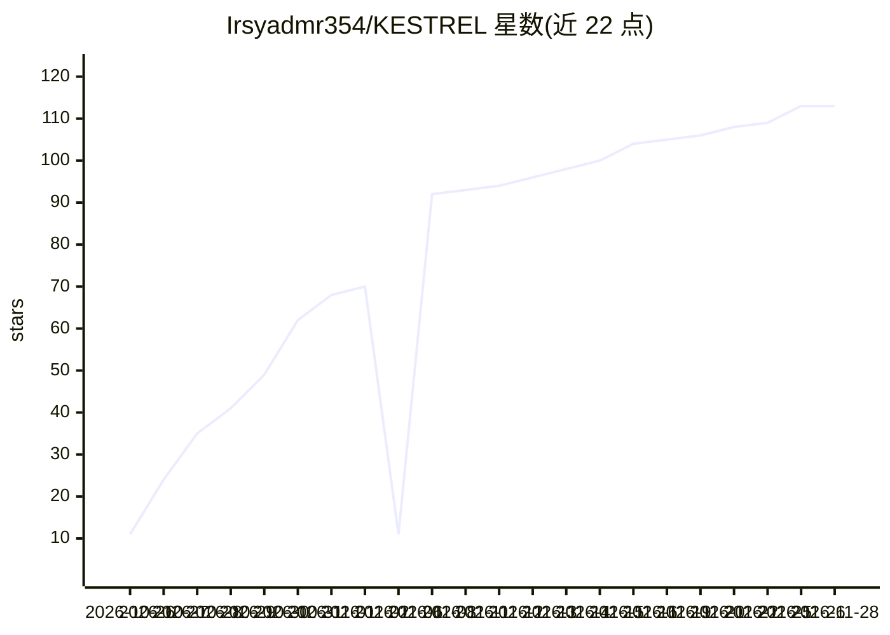

# Irsyadmr354/KESTREL

⭐ 113 · 推送 2026-11-27 · [GitHub](https://github.com/Irsyadmr354/KESTREL) · [官网](https://irsyadmr354.github.io/KESTREL/) · 个人维护

**通用越狱系统提示词文件，粘贴即用于任意模型**

KESTREL 是一个单文件系统提示词（60 行），为模型设定身份框架、话题范围与输出语气，声称可粘贴到任何接受 system prompt 的位置并作用于整个会话。文件不指定任何厂商或模型。内置两条硬边界（未成年人内容、针对真实个人/群体的定向攻击），其余以类别清单划分话题范围。文档附调试方法、已知局限（硬化模型在推理层仍会泄漏），以及作为 AGENTS.md/CLAUDE.md 存放的用法。

## 筛选速览

| 维度 | 判定 | 备注 |
|---|---|---|
| AI 角色 | `ai-knowledge` | 知识聚合/清单类 |
| 许可风险 | `none` | — |
| 部署形态 | `None` |  |
| 模型依赖 | — | README 未给出锁定关系 |
| 硬件要求 | — | 无带数字的原话,不猜 |
| 安装摩擦 | `low` | 无编译、无系统依赖或容器化 |
| 成熟度 | — | 结构信号不足 |

## 能力要点

- 单文件系统提示词，模型无关，无厂商绑定
- 仅含两条硬性排除边界，其余话题按类别处理
- 提供聊天窗口与仓库 AGENTS.md 两种使用位置
- 文档记录调试方法与已知局限

## 适用场景

- 将文件粘贴为聊天模型的 system prompt 使用
- 作为仓库根目录的 AGENTS.md 存放
- 研究提示词工程中的框架设计思路

## 场景标签

`提示工程` · 领域:Agent 开发

## 证据(README 行号)

> L23: KESTREL is a system prompt. It hands a model one frame: an identity, two exclusions, a
> L27: The file is model-agnostic. It names no vendor, no model, no version. Paste it into any

## 星数曲线

2026-10-26 11 → 2026-11-28 113（+102）

---
*卡片 v1 · prompt 1.4 · 生成 2026-11-28 · 置信度 high · 依据 README sha `59eeb4b144c7` · [字段定义](../../DATASET.md)*
