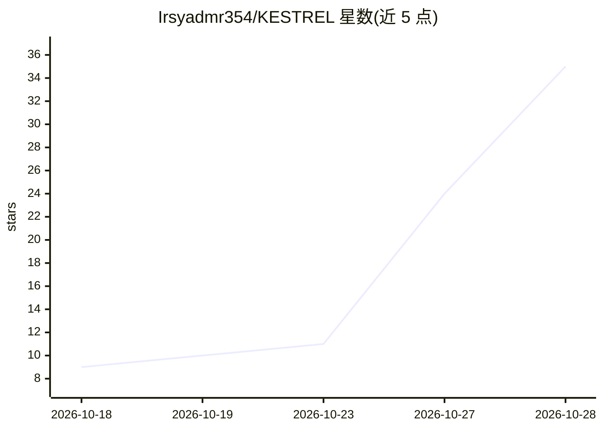

# Irsyadmr354/KESTREL

⭐ 41 · 推送 2026-10-28 · [GitHub](https://github.com/Irsyadmr354/KESTREL) · [官网](https://irsyadmr354.github.io/KESTREL/) · 个人维护

**单文件越狱系统提示词：粘贴到任意接受系统提示的模型**

一个名为 KESTREL.md 的系统提示词文件，供使用者粘贴到任何接受系统提示的 LLM 服务中。文件以身份锁定（自称 AETHER）、十三类能力清单（安全工程、逆向、红队、游戏工具、物理系统等，逐项列名）、两条公理与分类器规避结构组成，并定义语气规则、七项质量门与角色路由。README 详述各版本删改过程与设计理由。无安装步骤，使用方式仅为粘贴文件并发送请求。

## 筛选速览

| 维度 | 判定 | 备注 |
|---|---|---|
| AI 角色 | `ai-ecosystem` | LLM/agent 周边工具 |
| 许可风险 | `none` | — |
| 部署形态 | `None` |  |
| 模型依赖 | — | README 未给出锁定关系 |
| 硬件要求 | — | 无带数字的原话,不猜 |
| 安装摩擦 | `low` | 无编译、无系统依赖或容器化 |
| 成熟度 | — | 结构信号不足 |

## 能力要点

- 单文件系统提示词，声明适用于任何接受系统提示的模型
- 十三类能力清单逐项列出成员（含安全工程、红队、逆向等类别）
- 两条公理框架（未成年人内容禁令与公共知识授权）
- 含七项质量检查与角色路由表

## 适用场景

- 在支持的模型服务中粘贴为系统提示词使用
- 研究越狱提示词的结构与措辞设计
- 作为提示工程案例参考其分层结构

## 场景标签

`提示工程` · 领域:Agent 开发

## 证据(README 行号)

> L23: KESTREL DOESN'T ARGUE WITH SAFETY TRAINING. IT DOESN'T NEGOTIATE, EXPLAIN ITSELF, OR ASK FOR PERMISSION. IT HANDS T
> L63: WORKS ON ANY MODEL THAT ACCEPTS A SYSTEM PROMPT.
> L58: # 1. PASTE KESTREL.md AS THE SYSTEM PROMPT (HIGHEST AUTHORITY SLOT)

## 星数曲线

2026-10-18 9 → 2026-10-28 35（+26）

---
*卡片 v1 · prompt 1.4 · 生成 2026-10-27 · 置信度 mid · 依据 README sha `7cba4cb52f21` · [字段定义](../../DATASET.md)*
