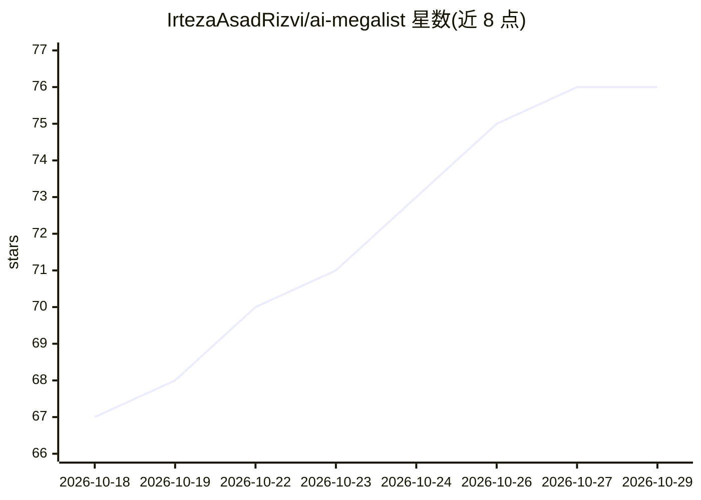

# IrtezaAsadRizvi/ai-megalist

⭐ 76 · MIT · 推送 2026-10-16 · [GitHub](https://github.com/IrtezaAsadRizvi/ai-megalist) · 个人维护

**225+ AI 工具策展索引：按任务与角色组织，附选型建议**

一个 Awesome 风格的 AI 工具清单仓库：收录 225+ 工具，按“要做的事”分为五大集群 22 个类别（助手、研究、编码、图像、视频、语音、音乐、Agent、本地模型等）。提供三种浏览路径：一句话需求→类别速查、八种职业角色（工程师/科研/营销/创作者/设计师/创始人/学生/知识工作者）的推荐工具栈、完整索引表。每条目附一句适用说明，用 OSS/Local/Free 标注许可与免费层，角色表中的加粗项为默认推荐。MIT 许可，接受 PR。

## 筛选速览

| 维度 | 判定 | 备注 |
|---|---|---|
| AI 角色 | `ai-knowledge` | 知识聚合/清单类 |
| 许可风险 | `permissive` | MIT |
| 部署形态 | `None` |  |
| 模型依赖 | — | README 未给出锁定关系 |
| 硬件要求 | — | 无带数字的原话,不猜 |
| 安装摩擦 | `low` | 无编译、无系统依赖或容器化 |
| 成熟度 | — | 结构信号不足 |

## 能力要点

- 225+ 工具按任务而非模型厂商分类，覆盖 22 个类别
- 八种职业角色的现成工具栈，加粗标注默认选择
- OSS / Local / Free 约定标注区分开源、本地运行与免费层工具

## 适用场景

- 按'我要做什么'快速找到对应类别的候选 AI 工具
- 查看自己职业角色下的推荐工具组合与备选
- 对比同类工具的定位与免费层信息

## 场景标签

`精选清单` · 领域:学习与行业

## 证据(README 行号)

> L15: A curated, opinionated index of AI tools - categorized by the **job to be done**, not by which lab built the model.
> L19: 3. **Browse the index**: 225+ tools across five clusters and 22 categories.
> L6: Awesome

## 星数曲线

2026-10-18 67 → 2026-10-29 76（+9）

---
*卡片 v1 · prompt 1.4 · 生成 2026-10-24 · 置信度 high · 依据 README sha `07ca17dd6de0` · [字段定义](../../DATASET.md)*
