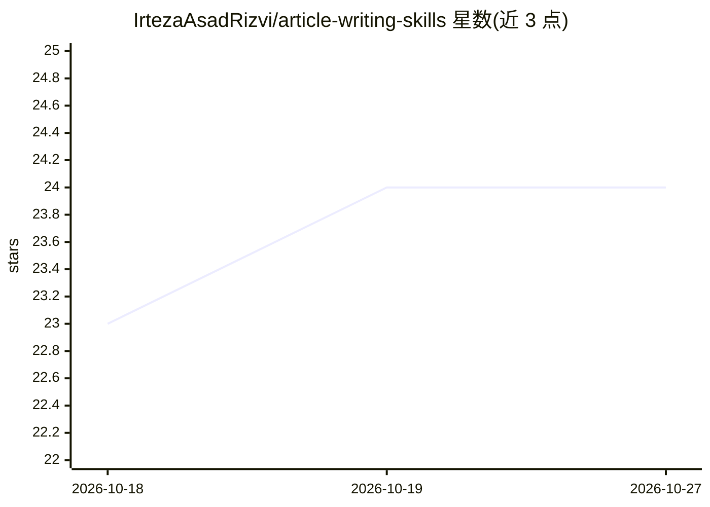

# IrtezaAsadRizvi/article-writing-skills

⭐ 24 · MIT · 推送 2026-04-19 · [GitHub](https://github.com/IrtezaAsadRizvi/article-writing-skills) · 个人维护

**以知名工程师思维为范式的写作提示词/技能合集**

收录结构化写作技能（SKILL.md 格式的提示词集合），模拟知名工程师与研究者（如 Andrej Karpathy）的思考与写作方式，用于探索主题、起草文章/博客/论文。技能为纯 Markdown，可载入 Claude Code 技能目录，或作为系统提示粘贴到 Claude、ChatGPT、Gemini 等任意 LLM。README 明确声明不用于代笔冒充本人、不追求表层文风模仿、非官方关联。当前含 1 个技能，接受社区贡献。

## 筛选速览

| 维度 | 判定 | 备注 |
|---|---|---|
| AI 角色 | `ai-knowledge` | 知识聚合/清单类 |
| 许可风险 | `permissive` | MIT |
| 部署形态 | `None` |  |
| 模型依赖 | — | README 未给出锁定关系 |
| 硬件要求 | — | 无带数字的原话,不猜 |
| 安装摩擦 | `low` | 无编译、无系统依赖或容器化 |
| 成熟度 | — | 结构信号不足 |

## 能力要点

- 以 SKILL.md 形式捕获特定研究者的思考模式
- 模型无关的纯 Markdown，可用作任意 LLM 的系统提示
- 提供 Claude Code 技能目录加载与粘贴两种使用方式
- MIT 许可，接受社区 PR 贡献新技能

## 适用场景

- 写技术博客或论文时借用特定专家的思考框架破题
- 以喜欢的教育者会采用的方式理解难懂概念
- 为自定义 GPT/Claude Projects/Cursor rules 配置写作提示

## 场景标签

`提示工程` `AI 写作` · 领域:Agent 开发

## 证据(README 行号)

> L3: > A curated collection of **writing skills, prompts, and system prompts** modeled on how famous engineers, scientist
> L17: This repo holds **"article-writing skills"** — structured prompts that capture *how* a specific well-known engineer
> L60: Yes — specifically for *article, blog, and paper writing* through the lens of specific thinkers. Each skill is a se

## 星数曲线

2026-10-18 23 → 2026-10-27 24（+1）

---
*卡片 v1 · prompt 1.4 · 生成 2026-10-27 · 置信度 high · 依据 README sha `6628b00633c1` · [字段定义](../../DATASET.md)*
