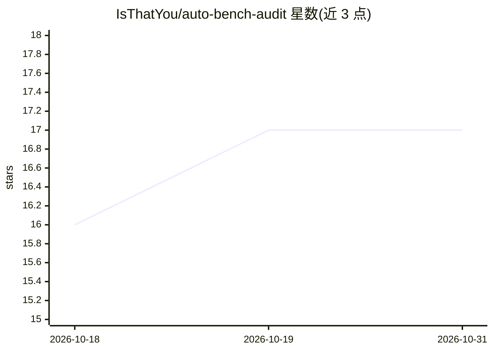

# IsThatYou/auto-bench-audit

⭐ 17 · HTML · 推送 2026-05-27 · [GitHub](https://github.com/IsThatYou/auto-bench-audit) · [官网](https://autobenchaudit.com) · 组织维护

**自动审计 LLM/agent 基准的管线：发现任务歧义与评测缺陷**

面向 LLM 与 agent 基准评测的自动化审计管线（agentic pipeline）：三阶段流程——基准级审计、将异构工件归一为统一任务清单的证据收集、逐任务审计并输出结构化发现（声明、严重度、证据路径、建议修复），沿 Instruction/Environment/Evaluation 三轴打分。支持静态与轨迹两种审计模式，轨迹可借助 Harbor 生成；审计 agent 可切换 claude/cursor/codex CLI。一条命令即可审计任意公开基准仓库（如 HLE、Terminal-Bench 2）。需 Python 3.12+，用 uv 管理依赖并配置 API key。

## 筛选速览

| 维度 | 判定 | 备注 |
|---|---|---|
| AI 角色 | `ai-ecosystem` | LLM/agent 周边工具 |
| 许可风险 | `none` | — |
| 部署形态 | `None` |  |
| 模型依赖 | — | README 未给出锁定关系 |
| 硬件要求 | — | 无带数字的原话,不猜 |
| 安装摩擦 | `low` | 无编译、无系统依赖或容器化 |
| 成熟度 | — | 结构信号不足 |

## 能力要点

- 三阶段审计：基准级审计→证据收集→逐任务审计
- 沿 Instruction/Environment/Evaluation 三轴输出 0/1/2 评分的结构化发现
- 支持静态审计与基于记录轨迹的 trajectory 审计两种模式
- audit_one.sh 一条命令审计任意公开基准的 GitHub 仓库

## 适用场景

- 基准发布前自查任务歧义、环境冲突与评测缺陷
- 对 HLE、GPQA、SWE-bench 等静态 QA 与 agentic 基准做批量审计
- 复现论文中基准审计实验并引用结果

## 场景标签

`模型评测` · 领域:评测与运维

## 证据(README 行号)

> L13: **`auto-bench-audit`** (ABA) is an agentic pipeline that audits LLM and agent benchmarks for task ambiguity, enviro

## 星数曲线

2026-10-18 16 → 2026-10-31 17（+1）

---
*卡片 v1 · prompt 1.4 · 生成 2026-10-30 · 置信度 high · 依据 README sha `ce4820904869` · [字段定义](../../DATASET.md)*
