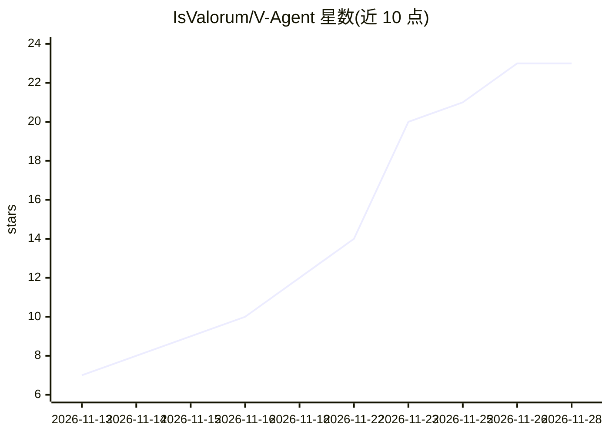

# IsValorum/V-Agent

⭐ 23 · Python · Apache-2.0 · 推送 2026-11-27 · [GitHub](https://github.com/IsValorum/V-Agent) · 个人维护

**Windows 本地优先 AI agent：运行 GGUF 模型并提供真实工具**

面向 Windows 的本地优先 AI agent 桌面应用：内置 Strata、Strata Rust、llama.cpp、Project Maya 四个本地引擎运行 GGUF 模型，也可接入 OpenAI/Claude/Azure/OpenRouter 等远程 API。通过 7 个 MCP 工具服务器提供文件读写、命令执行、DuckDuckGo 网络搜索、无头浏览器、桌面自动化等工具，每个动作由核心权限系统审批。提供 Hugging Face 模型浏览下载、GPU/RAM 内存估算器、代码语法检查、Ed25519 签名更新、5 语言界面；无广告、无账号、无遥测。

## 筛选速览

| 维度 | 判定 | 备注 |
|---|---|---|
| AI 角色 | `ai-ecosystem` | LLM/agent 周边工具 |
| 许可风险 | `permissive` | Apache-2.0 |
| 部署形态 | `desktop` | 安装包/桌面程序 |
| 模型依赖 | local-ok | 支持本地模型 |
| 硬件要求 | — | 无带数字的原话,不猜 |
| 安装摩擦 | `medium` | 含编译或系统依赖之一 |
| 成熟度 | — | 结构信号不足 |

## 能力要点

- 四个本地引擎运行 GGUF 模型，支持自定义预编译二进制
- 7 个 MCP 工具服务器：文件、命令、搜索、浏览器、桌面自动化等，带逐动作审批
- GPU/RAM 内存估算器与实时 tok/s 遥测
- Ed25519 签名更新与 SHA-256 校验，绑定 127.0.0.1 无遥测

## 适用场景

- 在个人电脑上离线运行本地模型并赋予其文件与浏览器工具
- 需要在每个工具动作上保留人工审批的 agent 工作流
- 通过 Hugging Face 浏览器按硬件适配挑选并下载量化模型

## 场景标签

`GUI 自动化` `推理引擎` `AI 助手` · 领域:效率与自动化

## 证据(README 行号)

> L3: **A local-first AI agent for Windows.**
> L25: V-Agent doesn't just point at a server you manage yourself: **Strata, Strata Rust, llama.cpp, and Project Maya**
> L44: V-Agent ships seven coordinated MCP tool servers configured per chat and governed by core-enforced permissions:

## 星数曲线

2026-11-13 7 → 2026-11-28 23（+16）

---
*卡片 v1 · prompt 1.4 · 生成 2026-11-18 · 置信度 high · 依据 README sha `9e2fe36b533c` · [字段定义](../../DATASET.md)*
