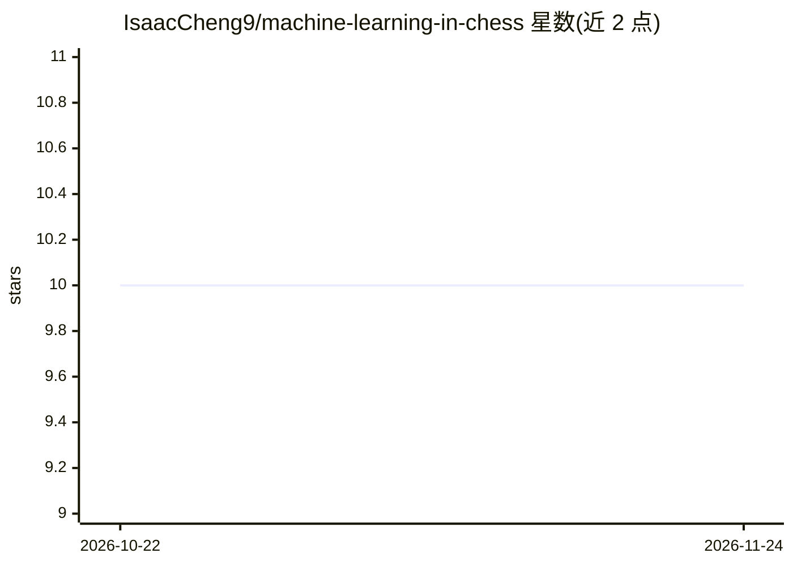

# IsaacCheng9/machine-learning-in-chess

⭐ 10 · Jupyter Notebook · 推送 2026-10-07 · [GitHub](https://github.com/IsaacCheng9/machine-learning-in-chess) · 个人维护

**用机器学习分析数百万国际象棋对局模式的学生研究项目**

埃克塞特大学本科毕业项目，基于 Lichess 开放数据库约 3.5 亿局对局（~350 GB）开展数据挖掘。构建数据处理管道，通过 pgn-extract 分割 PGN 文件、脚本转换为 Parquet/CSV，使用 Jupyter Notebook 进行分析：分类模型预测对局结果、回归模型研究开局流行度与结果关系、k-means 聚类按结果对开局分组。提供预处理好的 40,121,728 局数据集， Poetry 管理依赖。

## 筛选速览

| 维度 | 判定 | 备注 |
|---|---|---|
| AI 角色 | `ai-native` | 本体是模型或模型工具 |
| 许可风险 | `none` | — |
| 部署形态 | `None` |  |
| 模型依赖 | — | README 未给出锁定关系 |
| 硬件要求 | — | 无带数字的原话,不猜 |
| 安装摩擦 | `low` | 无编译、无系统依赖或容器化 |
| 成熟度 | — | 结构信号不足 |

## 能力要点

- 提供 2022 全年 40,121,728 局 Lichess 预处理数据集（resources 目录）
- 分类/回归/k-means 三类模型分析开局与胜负关系
- pgn-extract 分割 + 脚本转 Parquet 的并行处理管道
- CSV 可转 SQLite3 便于手工查询探索

## 适用场景

- 复现基于大规模 Lichess 对局的机器学习分析
- 研究国际象棋开局与对局结果的关联模式
- 学习大型棋谱数据的清洗与并行处理流程

## 场景标签

`数据分析` · 领域:效率与自动化

## 证据(README 行号)

> L21: implemented classification models to predict game outcomes, a regression model
> L22: to investigate opening popularity and game outcomes, and k-means clustering to

## 星数曲线

2026-10-22 10 → 2026-11-24 10（+0）

---
*卡片 v1 · prompt 1.4 · 生成 2026-11-20 · 置信度 high · 依据 README sha `66404ec72e4c` · [字段定义](../../DATASET.md)*
