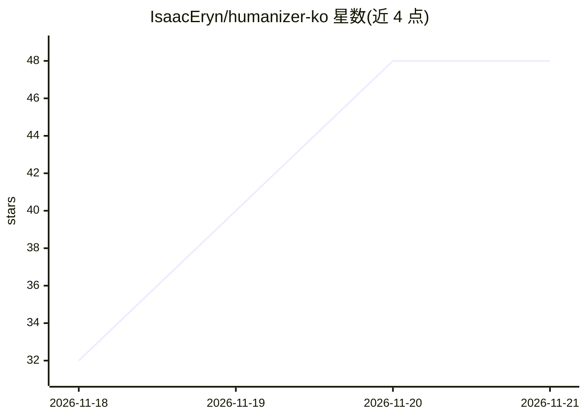

# IsaacEryn/humanizer-ko

⭐ 48 · Python · MIT · 推送 2026-10-21 · [GitHub](https://github.com/IsaacEryn/humanizer-ko) · 个人维护

**去除韩语文本中 AI 写作痕迹的 Claude Code 代理技能**

基于 blader/humanizer v2.9.1 改写、面向韩国语的代理技能，运行时产物为单个 SKILL.md，可被 Claude Code 及任何读取技能格式指令的代理加载。检测双被动、翻译腔、文体混用、代词/复数滥用等 37 个韩语特有模式，另有学术稿件（A1-A7）与演讲稿参考文件。机制上保留原版的误报防护（以模式集群而非单次出现判定）、草稿-审计-终稿循环与禁止虚构事实规则；正式体、公文惯用语等韩语正常写作习惯不视为痕迹。提供 skills CLI、Claude Code 插件与手动 clone 三种安装方式。

## 筛选速览

| 维度 | 判定 | 备注 |
|---|---|---|
| AI 角色 | `ai-ecosystem` | LLM/agent 周边工具 |
| 许可风险 | `permissive` | MIT |
| 部署形态 | `library` | 以包/库形式分发 |
| 模型依赖 | — | README 未给出锁定关系 |
| 硬件要求 | — | 无带数字的原话,不猜 |
| 安装摩擦 | `low` | 无编译、无系统依赖或容器化 |
| 成熟度 | — | 结构信号不足 |

## 能力要点

- 37 个韩语专用检测模式（双被动、翻译腔、文体混用等）
- 以模式集群判定而非单一命中，含公文/学术等体裁误报防护
- 禁止在改写中添加原文没有的事实、名字、数字与出处
- 可依据用户自己的文字样本调整文体习惯

## 适用场景

- 把 ChatGPT/Claude 生成的韩语初稿改成更像人写的文章
- 清理韩语报告或博客中的翻译腔和套路化表达
- 在不破坏正式文体的前提下整理学术论文或公文的 AI 痕迹

## 场景标签

`AI 写作` · 领域:内容生成

## 证据(README 行号)

> L3: 한국어 텍스트에서 AI 생성 글의 티를 찾아 제거하는 에이전트 스킬입니다. blader/humanizer를 바탕으로 패턴 전체를 한국어에 맞게 다시 설계했고, 지금은 37개 패턴을 다룹니다. 순수 Markdo
> L5: **English:** A portable agent skill that removes signs of AI-generated writing from **Korean** text. Derived from bl
> L60: 런타임 산출물이 `SKILL.md` 하나라서 어떤 하네스에서도 직접 쓸 수 있습니다. 하네스가 스킬 디렉터리를 찾는 곳에 저장소를 두면 됩니다:

## 星数曲线

2026-11-18 32 → 2026-11-21 48（+16）

---
*卡片 v1 · prompt 1.4 · 生成 2026-11-18 · 置信度 high · 依据 README sha `28c4fdf4b7e0` · [字段定义](../../DATASET.md)*
