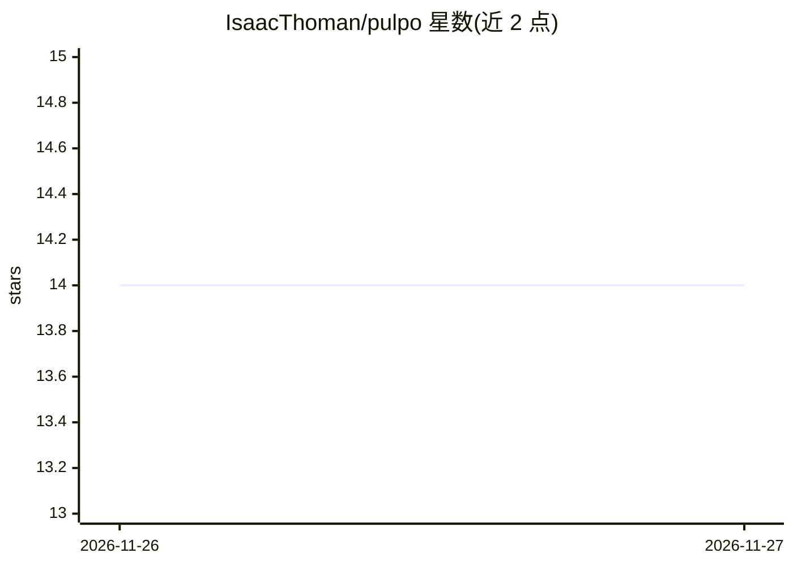

# IsaacThoman/pulpo

⭐ 14 · TypeScript · NOASSERTION · 推送 2026-11-26 · [GitHub](https://github.com/IsaacThoman/pulpo) · [官网](https://pulpo.baby) · 个人维护

**自托管多端同步的 AI 聊天平台，覆盖 iOS/Android/Web**

自托管的日常聊天机器人平台：服务端由 Fastify API、PostgreSQL、Redis、S3 存储与 Ollama 组成，通过 Docker Compose 一键启动；客户端包括 React Native 移动应用、Electron 桌面应用、Web 端与管理用 CLI，多设备间实时同步会话。模型来源自定：可在自有 GPU 上运行开放权重模型，或接入托管 API，会话中途可切换模型与 provider。Agent 模式为每次任务分配一台带 root 的轻量虚拟机，预装 Python/Node.js/Git/FFmpeg，会话结束即销毁。许可为非商业许可，营利性使用需商业授权。

## 筛选速览

| 维度 | 判定 | 备注 |
|---|---|---|
| AI 角色 | `ai-native` | 本体是模型或模型工具 |
| 许可风险 | `none` | NOASSERTION |
| 部署形态 | `self-host` | docker 或自建部署 |
| 模型依赖 | local-ok | 支持本地模型 |
| 硬件要求 | — | 无带数字的原话,不猜 |
| 安装摩擦 | `low` | 无编译、无系统依赖或容器化 |
| 成熟度 | — | 结构信号不足 |

## 能力要点

- 多端（iOS/Android/Web/桌面）实时同步会话与流式输出
- 兼容 OpenAI/Anthropic/Mistral API 格式，会话中可切换模型与 provider
- Agent 模式为每任务提供隔离的一次性 Linux 虚拟机
- 开发者 API 提供 OpenAI 与 Anthropic 兼容端点，自签发 key

## 适用场景

- 在自己服务器上搭建跨设备同步的私人聊天助手
- 接入本地 GPU 或已有托管 API，自由组合多个模型
- 让 agent 在隔离虚拟机中运行代码并处理文件

## 场景标签

`聊天机器人` `AI 助手` · 领域:对话与助手

## 证据(README 行号)

> L3: **Self-hosted chatbot for everyday use**
> L20: Run open-weight models on your own GPUs, so conversations can stay on your network, or use the hosted APIs you alre
> L22: Pulpo speaks the OpenAI Responses, OpenAI Chat Completions, Anthropic Messages, and Mistral APIs. That covers vLLM,

## 星数曲线

2026-11-26 14 → 2026-11-27 14（+0）

---
*卡片 v1 · prompt 1.4 · 生成 2026-11-26 · 置信度 high · 依据 README sha `09ac42742502` · [字段定义](../../DATASET.md)*
