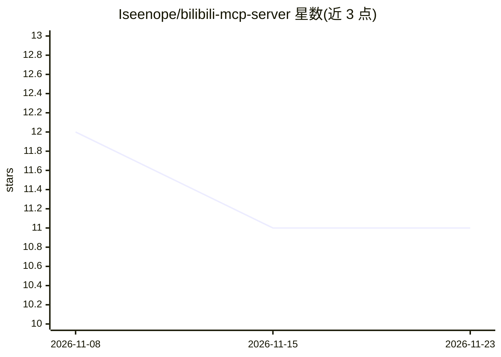

# Iseenope/bilibili-mcp-server

⭐ 11 · TypeScript · MIT · 推送 2026-11-20 · [GitHub](https://github.com/Iseenope/bilibili-mcp-server) · 个人维护 · 中文 README

**B 站 MCP 服务：让 AI 客户端调用哔哩哔哩视频、评论、弹幕等 31 个工具**

基于 Model Context Protocol 封装哔哩哔哩 API 的服务器，提供视频搜索、评论管理、弹幕字幕、用户信息、动态专栏、扫码登录、直播截图视觉分析等 31 个工具，通过标准 MCP 配置接入客户端。需 Node.js 22+ 与 B 站账号 Cookie（SESSDATA/bili_jct），支持扫码登录自动保存 Cookie。视频下载依赖 ffmpeg 合并 DASH 音视频；弹幕发送与关注操作受 B 站风控限制。

## 筛选速览

| 维度 | 判定 | 备注 |
|---|---|---|
| AI 角色 | `ai-ecosystem` | LLM/agent 周边工具 |
| 许可风险 | `permissive` | MIT |
| 部署形态 | `library` | 以包/库形式分发 |
| 模型依赖 | — | README 未给出锁定关系 |
| 硬件要求 | — | 无带数字的原话,不猜 |
| 安装摩擦 | `medium` | 含编译或系统依赖之一 |
| 成熟度 | — | 结构信号不足 |

## 能力要点

- 31 个工具覆盖视频、弹幕、字幕、评论、直播、用户、专栏
- 扫码登录自动保存与 Cookie 刷新
- 直播截图作为图片返回给具备视觉能力的模型分析
- 视频下载后用 ffmpeg 自动合并为 mp4

## 适用场景

- 在支持 MCP 的客户端里搜索和查询 B 站视频与评论
- 让 AI 读取视频字幕和弹幕后做总结分析
- 通过 AI 发评论、点赞、发弹幕（注意风控限制）
- 下载 B 站视频或将专栏保存为 Markdown

## 场景标签

`网页抓取` · 领域:效率与自动化

## 证据(README 行号)

> L5: B 站的 MCP 服务。提供视频搜索、评论管理、弹幕字幕、用户信息、动态专栏、扫码登录、直播截图视觉分析等功能，共 31 个工具。
> L27: - Node.js 22+
> L53: ### MCP 客户端配置

## 星数曲线

2026-11-08 12 → 2026-11-23 11（-1）

---
*卡片 v1 · prompt 1.4 · 生成 2026-11-19 · 置信度 high · 依据 README sha `f570918570f0` · [字段定义](../../DATASET.md)*
