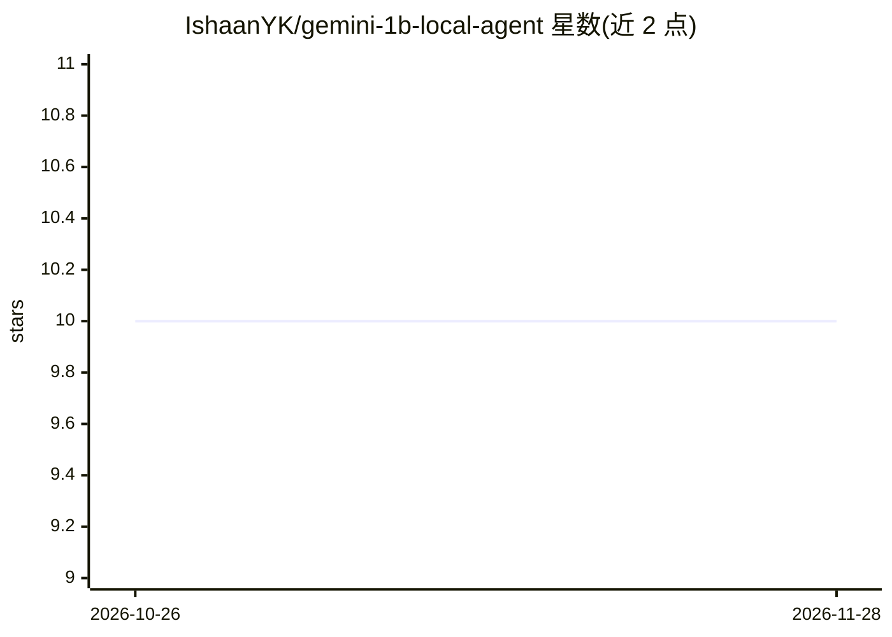

# IshaanYK/gemini-1b-local-agent

⭐ 10 · Python · MIT · 推送 2026-09-25 · [GitHub](https://github.com/IshaanYK/gemini-1b-local-agent) · 个人维护

**面向开发者的免费 Gemini 驱动自主编码代理**

基于 Google Gemini 2.0 Flash/Pro Exp 的自主编码代理，通过 OpenAI 兼容的 Web2API 代理接入 Gemini Web，宣称无需 API key。提供 6 个本地系统工具（PowerShell 命令、文件读写/编辑、grep 搜索、目录列举）、10 步自主工具链、74 个设计/工程技能包、Apple HIG 风格 Web UI 与会话上下文交接（handoff.py）。依赖 Python，附 SETUP.bat 一键安装与 .bat 桌面启动脚本，后端为 Flask（端口 5000），代理运行于 8081。

## 筛选速览

| 维度 | 判定 | 备注 |
|---|---|---|
| AI 角色 | `ai-native` | 本体是模型或模型工具 |
| 许可风险 | `permissive` | MIT |
| 部署形态 | `library` | 以包/库形式分发 |
| 模型依赖 | — | README 未给出锁定关系 |
| 硬件要求 | — | 无带数字的原话,不猜 |
| 安装摩擦 | `low` | 无编译、无系统依赖或容器化 |
| 成熟度 | — | 结构信号不足 |

## 能力要点

- 通过 OpenAI 兼容 Web2API 代理接入 Gemini Web，无需 API key
- 6 个本地系统工具与每轮最多 10 步自主工具链
- 74 个内置设计/工程技能（design-md-apple、design-md-stripe 等）
- 一键 .bat 桌面启动器：代理、后端、浏览器 UI 依次拉起

## 适用场景

- 用自然语言让代理在本机执行命令、写代码、改文件
- 以对话方式检索和阅读代码库内容
- 复用既有会话上下文继续编码任务（handoff 机制）

## 场景标签

`编码 Agent` `代码生成` `AI 助手` · 领域:编码与开发

## 证据(README 行号)

> L15: > **An autonomous, zero-cost AI coding agent powered by Google Gemini 2.0 Flash & Pro Exp with Deep Reasoning (1 Bi
> L34: - **🔓 100% Unlimited Without API Keys**: Interfaces with Gemini Web via an OpenAI-compatible Web2API proxy. Zero bi
> L36: - **⚡ 10-Step Autonomous Agentic Loop**: Automatically chains up to 10 consecutive tool actions per turn (`Create f

## 星数曲线

2026-10-26 10 → 2026-11-28 10（+0）

---
*卡片 v1 · prompt 1.4 · 生成 2026-11-20 · 置信度 high · 依据 README sha `6d154a041dbf` · [字段定义](../../DATASET.md)*
