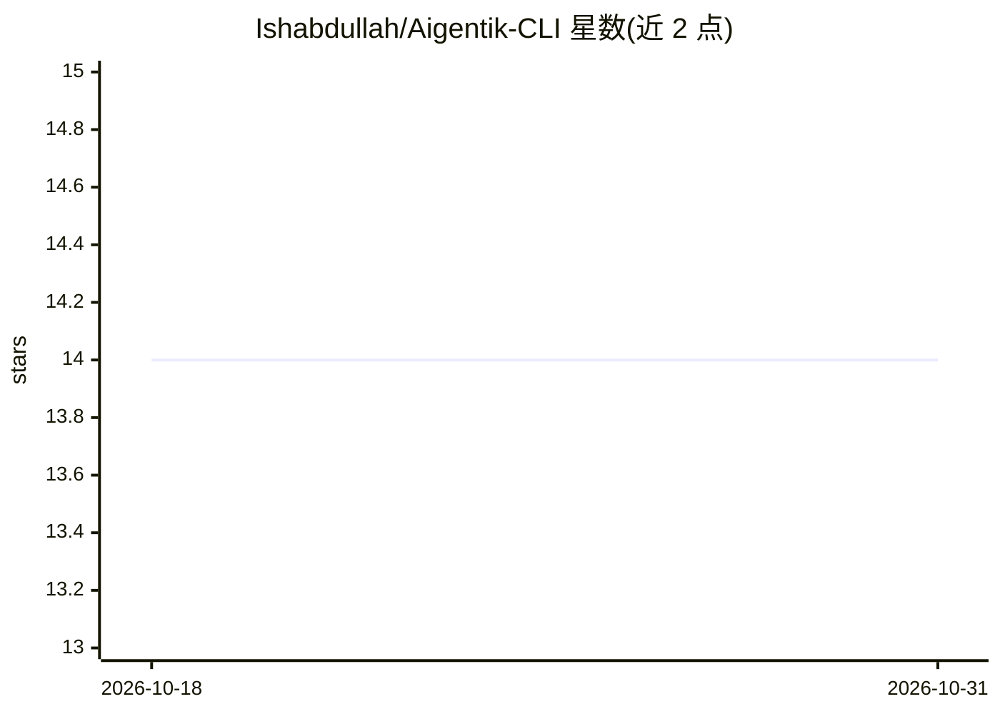

# Ishabdullah/Aigentik-CLI

⭐ 14 · JavaScript · MIT · 推送 2026-08-27 · [GitHub](https://github.com/Ishabdullah/Aigentik-CLI) · 个人维护

**跑在手机/迷你主机上的本地邮件 AI 助理，自动回复 Gmail**

运行于 Termux/Android 或 Linux 的隐私优先 AI 通讯助理：以 IMAP IDLE 实时监听 Gmail 收件箱，用本地 llama.cpp 模型起草/发送回复，同一管道处理 Google Voice 转发的短信；支持自然语言指令控制、端到端预约排期（生成 .ics 邀请，无需日历 API/OAuth）、自建联系人目录、分包商申请表识别与规则引擎自动化。全程无云 AI、无 API key，AI 调用仅为发往 127.0.0.1 上 llama-server 的本地 HTTP 请求。安装脚本完成依赖安装、llama.cpp 编译、GGUF 模型下载与配置生成；需 Node.js>=18 与 Gmail App Password。

## 筛选速览

| 维度 | 判定 | 备注 |
|---|---|---|
| AI 角色 | `ai-native` | 本体是模型或模型工具 |
| 许可风险 | `permissive` | MIT |
| 部署形态 | `library` | 以包/库形式分发 |
| 模型依赖 | local-ok | 支持本地模型 |
| 硬件要求 | — | 无带数字的原话,不猜 |
| 安装摩擦 | `low` | 无编译、无系统依赖或容器化 |
| 成熟度 | — | 结构信号不足 |

## 能力要点

- Gmail IMAP IDLE 实时监听与本地模型起草/自动发送回复
- 自然语言指令控制（短信/邮件直接下指令）
- 预约排期生成 .ics 邀请，无需日历 API 或 OAuth
- 规则引擎处理常规邮件，未自动发送的回复进入人工审批队列

## 适用场景

- 让手机/迷你主机自动处理 Gmail 收件箱并代拟回复
- 通过短信或邮件用自然语言指挥助理执行操作
- 为小生意自动回复咨询并安排预约、登记分包商信息

## 场景标签

`AI 助手` `工作流自动化` · 领域:效率与自动化

## 证据(README 行号)

> L11: Aigentik is a privacy-first AI assistant that runs locally — on an Android phone via Termux, or on a regular Linux 
> L51: - Local LLM inference with `llama.cpp` — no cloud calls for AI
> L71: Everything runs as one long-lived Node.js process with a single IMAP connection watching Gmail in real time. All AI

## 星数曲线

2026-10-18 14 → 2026-10-31 14（+0）

---
*卡片 v1 · prompt 1.4 · 生成 2026-10-31 · 置信度 mid · 依据 README sha `f9573ee176b5` · [字段定义](../../DATASET.md)*
