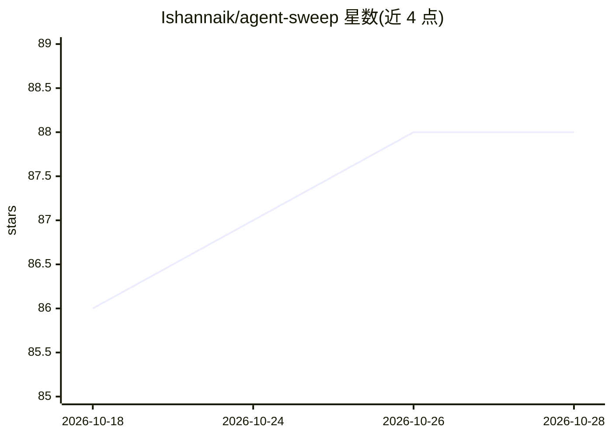

# Ishannaik/agent-sweep

⭐ 88 · Python · MIT · 推送 2026-10-27 · [GitHub](https://github.com/Ishannaik/agent-sweep) · 个人维护

**扫描并就地脱敏 AI 编程助手本地历史中泄露密钥的离线 CLI**

面向开发者的命令行安全工具：扫描 32 种 AI 编程助手（Claude Code、Codex、Cursor 等）在本地磁盘留下的明文 JSONL/SQLite 会话历史，用 207 条正则规则加 BIP-39 助记词检测识别 AWS/GitHub/OpenAI/Anthropic 等密钥，可就地脱敏（保持 JSONL 字节结构）、给出各服务商的密钥轮换链接，并以 .bak 备份支持一键撤销。全程离线、零网络调用。安装支持 uv/pipx/pip 与 Docker，提供交互菜单与脚本化两种模式；部分 agent 来源标注为实验性（未经真实安装验证）。项目自述处于 Alpha 阶段。

## 筛选速览

| 维度 | 判定 | 备注 |
|---|---|---|
| AI 角色 | `ai-ecosystem` | LLM/agent 周边工具 |
| 许可风险 | `permissive` | MIT |
| 部署形态 | `self-host` | docker 或自建部署 |
| 模型依赖 | — | README 未给出锁定关系 |
| 硬件要求 | — | 无带数字的原话,不猜 |
| 安装摩擦 | `low` | 无编译、无系统依赖或容器化 |
| 成熟度 | `idea` | |

## 能力要点

- 支持 32 种 AI 编程助手的历史文件扫描（部分为实验性来源）
- 207 条正则规则 + BIP-39 助记词检测，覆盖主流云服务商密钥与 PEM/JWT
- 8 项安全不变量：原子替换、强制备份、符号链接拒绝、写后校验，undo 可逆
- 完全离线运行，零网络调用

## 适用场景

- 排查我曾粘贴到 AI 编程助手对话里的 API 密钥泄露
- 在密钥轮换前批量脱敏本地 agent 历史文件
- 在 CI 或脚本中定期审计开发机上的 agent 历史泄露情况

## 场景标签

`网络安全` · 领域:学习与行业

## 证据(README 行号)

> L5: **Find and redact secrets in your AI coding agent's local history. Fully offline.**
> L25: **32 agents supported:** Claude Code · Codex · OpenCode · Cursor · Windsurf · Aider · Cline · Kilo Code · Roo Code 
> L37: Claude Code (and every other AI coding CLI) stores your full conversation history as plain-text JSONL on disk, unde

## 星数曲线

2026-10-18 86 → 2026-10-28 88（+2）

---
*卡片 v1 · prompt 1.4 · 生成 2026-10-23 · 置信度 high · 依据 README sha `257e7368cb07` · [字段定义](../../DATASET.md)*
