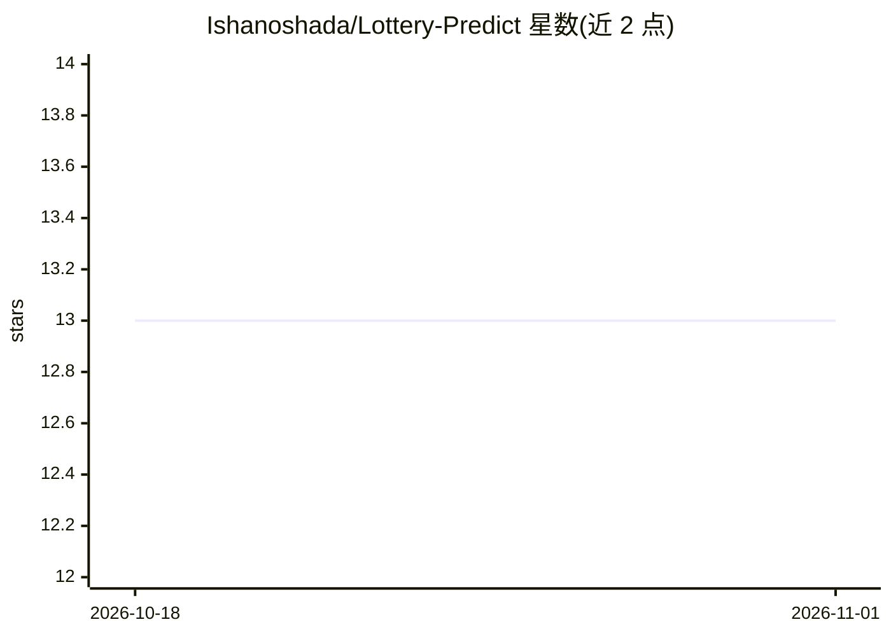

# Ishanoshada/Lottery-Predict

⭐ 13 · Python · MIT · 推送 2026-10-08 · [GitHub](https://github.com/Ishanoshada/Lottery-Predict) · [官网](https://lottery-predict.vercel.app) · 个人维护

**上传历史彩票数据、用机器学习预测下一期号码的 Flask 网页应用**

基于 Flask 的 Web 应用：用户拖拽上传 .xlsx 格式的历史开奖数据（日期 + Num1-Num6 + 可选 Bonus 列），点击分析后通过 Server-Sent Events 实时展示分析过程，并以动画“幸运球”形式展示预测号码。内置示例文件可下载，界面适配桌面与移动端。技术栈为 Flask、pandas 与 scikit-learn。运行需 Python 3.8+，克隆仓库、pip 安装依赖后执行 api/app.py 启动，访问 localhost:5000 使用。

## 筛选速览

| 维度 | 判定 | 备注 |
|---|---|---|
| AI 角色 | `ai-native` | 本体是模型或模型工具 |
| 许可风险 | `permissive` | MIT |
| 部署形态 | `library` | 以包/库形式分发 |
| 模型依赖 | — | README 未给出锁定关系 |
| 硬件要求 | — | 无带数字的原话,不猜 |
| 安装摩擦 | `low` | 无编译、无系统依赖或容器化 |
| 成熟度 | — | 结构信号不足 |

## 能力要点

- 上传 .xlsx 历史开奖数据并用机器学习预测号码
- Server-Sent Events 实时展示分析过程
- 动画“幸运球”展示预测结果
- 内置示例数据文件与格式说明

## 适用场景

- 我想上传自己收集的开奖记录看看分析结果
- 用内置示例文件快速体验预测流程
- 在桌面或手机浏览器中查看实时分析与预测动画

## 场景标签

 · 领域:娱乐/数据分析 Web 应用

## 证据(README 行号)

> L21: Lottery-Predict is a modern web application built with Flask, designed to analyze historical lottery data from Exce
> L108: - Powered by Flask, pandas, and scikit-learn.

## 星数曲线

2026-10-18 13 → 2026-11-01 13（+0）

---
*卡片 v1 · prompt 1.4 · 生成 2026-10-31 · 置信度 mid · 依据 README sha `5e3db26c34fa` · [字段定义](../../DATASET.md)*
