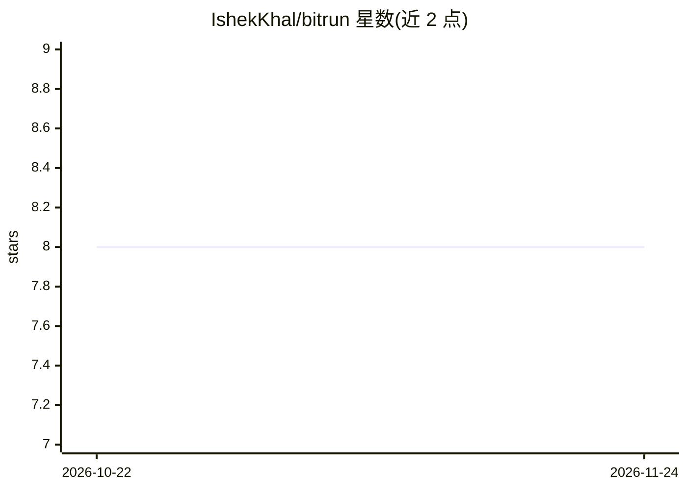

# IshekKhal/bitrun

⭐ 8 · Go · MIT · 推送 2026-10-15 · [GitHub](https://github.com/IshekKhal/bitrun) · 个人维护

**CPU 上一比特/1.58 比特三元 LLM 的零编译运行器与终端仪表盘**

BitRun 将本地 CPU 推理引擎打包为独立运行的 CLI 工具，面向 1-bit/1.58-bit 三元权重大模型，无需编译工具链或外部依赖。内置 6 个模型注册表（70M–8B），支持从 Hugging Face 拉取权重（断点续传）、交互式聊天、基准测试，以及 Go/Bubble Tea 实现的全屏终端 Cockpit，实时显示 TTFT、生成速度、P/E 核利用率与瓦特功耗、每 token 焦耳等遥测。通过 OpenAI 兼容 REST API（端口 11435）对外服务，引擎基于 llama.cpp 静态编译二进制。

## 筛选速览

| 维度 | 判定 | 备注 |
|---|---|---|
| AI 角色 | `ai-ecosystem` | LLM/agent 周边工具 |
| 许可风险 | `permissive` | MIT |
| 部署形态 | `desktop` | 安装包/桌面程序 |
| 模型依赖 | local-ok | 支持本地模型 |
| 硬件要求 | — | 无带数字的原话,不猜 |
| 安装摩擦 | `low` | 无编译、无系统依赖或容器化 |
| 成熟度 | — | 结构信号不足 |

## 能力要点

- 零编译独立运行器，自动适配 AVX2/AVX-512/ARM NEON SIMD 指令
- Cockpit 终端仪表盘：TTFT、吞吐、瓦特功耗、每 token 焦耳与预计续航
- OpenAI 兼容 REST API（端口 11435）与 Modelfile 自定义 persona
- 内置 6 个三元/紧凑模型注册表，支持 8B 模型纯 CPU 推理

## 适用场景

- 在笔记本 CPU 上本地运行 1-bit/1.58-bit 三元 LLM 对话
- 监测模型推理的实时功耗与每 token 能耗
- 通过 OpenAI 兼容 API 将本地三元模型接入 Cursor、Open WebUI 等工具
- 快速基准测试不同模型在自身硬件上的速度与能耗

## 场景标签

`推理引擎` `聊天机器人` · 领域:对话与助手

## 证据(README 行号)

> L3: > **Zero-compile runner, model manager, and live terminal dashboard for 1-bit and 1.58-bit ternary LLMs on Apple Sil
> L21: **BitRun packages the native inference engine into a standalone runner with zero external dependencies and a clean 
> L164: ## OpenAI-Compatible REST API

## 星数曲线

2026-10-22 8 → 2026-11-24 8（+0）

---
*卡片 v1 · prompt 1.4 · 生成 2026-11-20 · 置信度 mid · 依据 README sha `4e597fb17c2f` · [字段定义](../../DATASET.md)*
