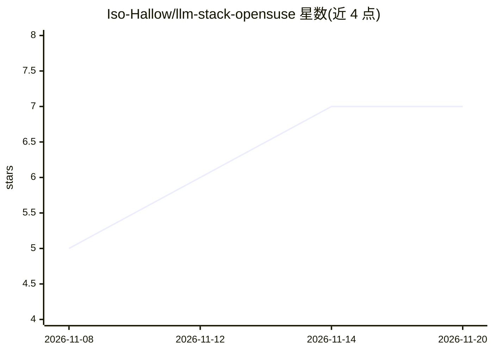

# Iso-Hallow/llm-stack-opensuse

⭐ 7 · 推送 2026-10-26 · [GitHub](https://github.com/Iso-Hallow/llm-stack-opensuse) · 个人维护

**openSUSE 无 GPU 本地 LLM 部署教程（Ollama+Open WebUI）**

一份俄文可复现部署手册：在 openSUSE Leap 16.0 上以纯 CPU 模式搭建本地 LLM 栈，Ollama 作 systemd 模型服务器、Open WebUI 以 Docker 运行为 Web 界面。覆盖网络监听配置、防火墙放行、模型拉取与不推荐模型清单、cloudflared 临时外网隧道及常见故障诊断。作者因两次重装系统丢失配置而写，目标是 30-40 分钟内完成恢复。许可证 CC BY-SA 4.0。

## 筛选速览

| 维度 | 判定 | 备注 |
|---|---|---|
| AI 角色 | `ai-knowledge` | 知识聚合/清单类 |
| 许可风险 | `none` | — |
| 部署形态 | `self-host` | docker 或自建部署 |
| 模型依赖 | local-ok | 支持本地模型 |
| 硬件要求 | — | 无带数字的原话,不猜 |
| 安装摩擦 | `low` | 无编译、无系统依赖或容器化 |
| 成熟度 | — | 结构信号不足 |

## 能力要点

- openSUSE Leap 16.0 上 Ollama（systemd）+ Open WebUI（Docker）的完整部署步骤
- 针对 AMD RX 5700 XT（gfx1010）官方 Ollama 无法识别 GPU 的情况，明确走 CPU 路径
- LAN 访问配置与 cloudflared 临时隧道（含安全警告）
- 已验证模型清单与不建议模型的原因表

## 适用场景

- 在 openSUSE 上从零搭建本地 Ollama + Open WebUI
- 无受支持 GPU 的机器上以 CPU 模式运行本地模型
- 重装系统后快速恢复原有 LLM 栈配置
- 局域网内多设备访问本地聊天界面

## 场景标签

`教程课程` · 领域:学习与行业

## 证据(README 行号)

> L13: ## О чём этот документ
> L15: Полное, воспроизводимое руководство по развёртыванию локального стека языковых моделей на openSUSE Leap 16.0 **без 

## 星数曲线

2026-11-08 5 → 2026-11-20 7（+2）

---
*卡片 v1 · prompt 1.4 · 生成 2026-11-20 · 置信度 high · 依据 README sha `da001feda4b5` · [字段定义](../../DATASET.md)*
