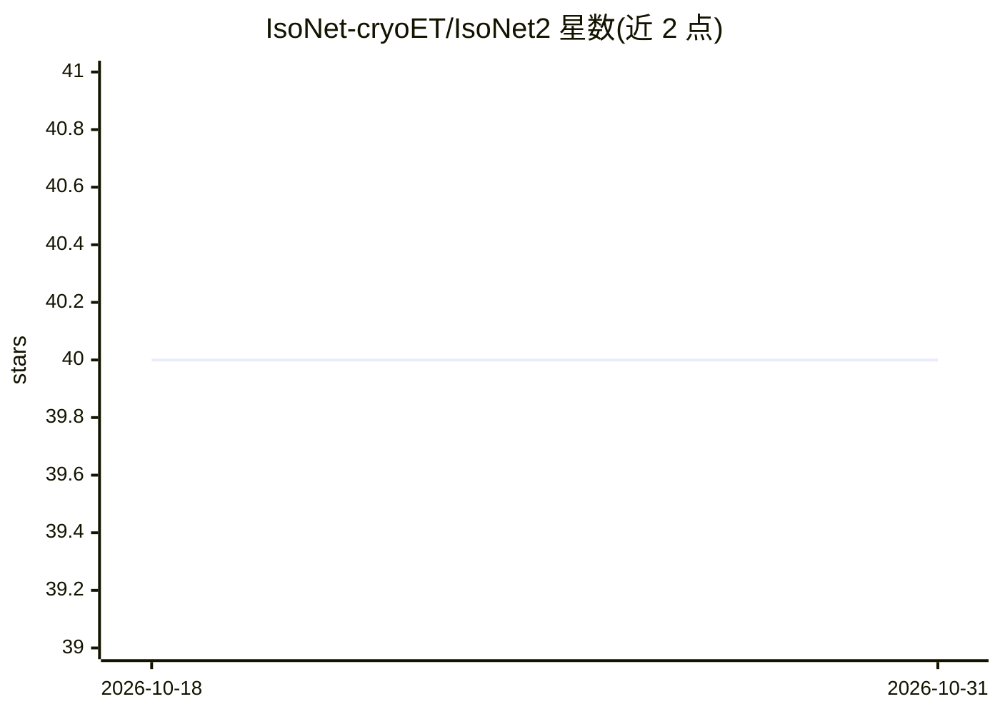

# IsoNet-cryoET/IsoNet2

⭐ 40 · Python · GPL-3.0 · 推送 2026-10-29 · [GitHub](https://github.com/IsoNet-cryoET/IsoNet2) · [官网](https://doi.org/10.64898/2025.12.09.693325) · 组织维护

**冷冻电子断层扫描重建的深度学习校正软件：缺楔/去噪/CTF 联合校正**

面向冷冻电子断层成像（cryo-ET）科研用户的深度学习软件包：在原始断层图上训练神经网络，同时完成缺失楔校正、去噪与 CTF 校正。包含 prepare_star、deconv、make_mask、denoise、refine、predict 六个模块，以 .star 文件组织数据，提供 GUI 与 CLI 两种使用方式，支持 even/odd 配对数据的 Noise2Noise 训练。要求 Linux 64 位系统、NVIDIA GPU（Ampere 及以上推荐）、24 GB VRAM（推荐）与 CUDA >= 11.8，通过 conda 环境安装。

## 筛选速览

| 维度 | 判定 | 备注 |
|---|---|---|
| AI 角色 | `ai-native` | 本体是模型或模型工具 |
| 许可风险 | `viral` | GPL-3.0 |
| 部署形态 | `None` |  |
| 模型依赖 | — | README 未给出锁定关系 |
| 硬件要求 | `gpu-24g` | |
| 安装摩擦 | `medium` | 含编译或系统依赖之一 |
| 成熟度 | — | 结构信号不足 |

## 能力要点

- 单网络同时完成缺楔校正、去噪与 CTF 校正
- 六个模块化流程（prepare_star/deconv/make_mask/denoise/refine/predict），以 .star 文件组织
- 支持 even/odd 配对数据的 Noise2Noise 训练（按帧或倾角切分）
- 提供 GUI 与 CLI 两种使用方式，GUI 含任务队列与实时输出监控

## 适用场景

- 对 cryo-ET 断层图做缺楔与 CTF 校正以提升分辨率
- 对断层数据去噪以改善信噪比
- 生成用于后续细化训练的掩膜

## 场景标签

`科研工具` `图像视频处理` · 领域:学习与行业

## 证据(README 行号)

> L7: _IsoNet2_ is a deep-learning software package for simultaneous missing wedge correction, denoising, and CTF correcti
> L9: _IsoNet2_ contains six modules: **_prepare_star_**, **_deconv_**, **_make_mask_**, **_denoise_**, **_refine_**, and 

## 星数曲线

2026-10-18 40 → 2026-10-31 40（+0）

---
*卡片 v1 · prompt 1.4 · 生成 2026-10-25 · 置信度 high · 依据 README sha `ec9fcbf52507` · [字段定义](../../DATASET.md)*
