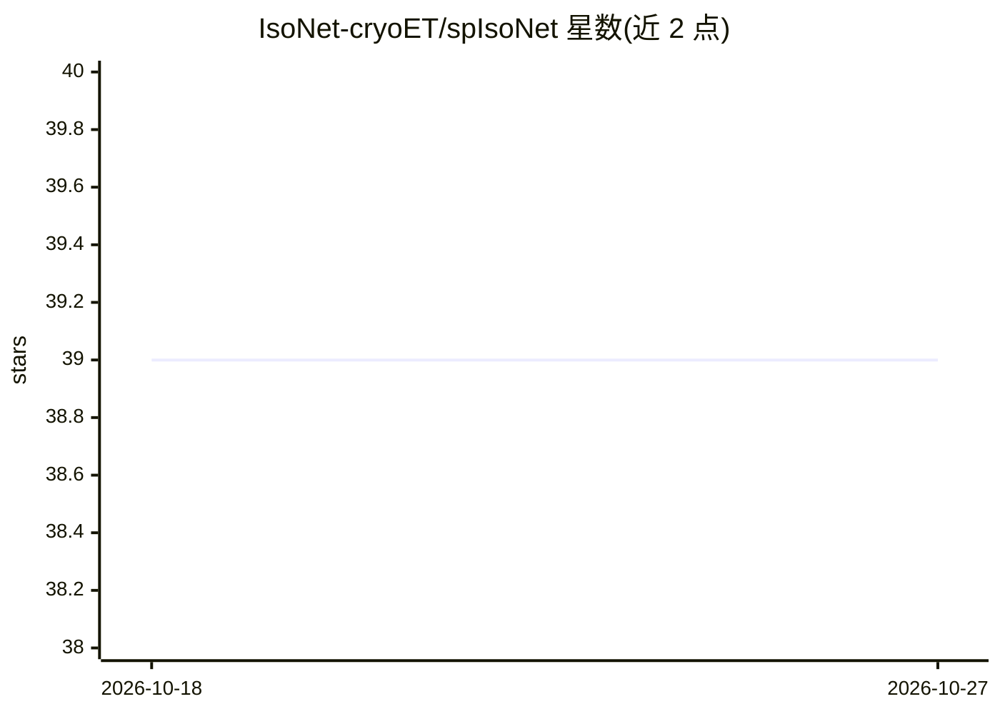

# IsoNet-cryoET/spIsoNet

⭐ 39 · Python · MIT · 推送 2026-04-29 · [GitHub](https://github.com/IsoNet-cryoET/spIsoNet) · [官网](https://www.nature.com/articles/s41592-024-02505-1) · 组织维护

**自监督深度学习修正 cryoEM 优势取向问题的软件**

面向冷冻电镜单颗粒分析与亚断层平均的深度学习工具：通过从原始数据中自主提取监督信号（无需显式输入-输出训练对），在傅里叶空间从充分采样取向上恢复缺失信息，修正优势取向问题。自监督机制保证了训练所用信息的可靠性。cryET 缺失楔校正需使用其姊妹项目 IsoNet。基于 conda/PyTorch/CUDA 环境安装，含与 RELION 对接的错位校正外部重构配置。

## 筛选速览

| 维度 | 判定 | 备注 |
|---|---|---|
| AI 角色 | `ai-native` | 本体是模型或模型工具 |
| 许可风险 | `permissive` | MIT |
| 部署形态 | `library` | 以包/库形式分发 |
| 模型依赖 | — | README 未给出锁定关系 |
| 硬件要求 | — | 无带数字的原话,不猜 |
| 安装摩擦 | `medium` | 含编译或系统依赖之一 |
| 成熟度 | — | 结构信号不足 |

## 能力要点

- 自监督学习，无需构造输入-输出训练对
- 在傅里叶空间恢复优势取向导致的缺失信息
- 支持单颗粒分析与亚断层平均
- 可配置 RELION 外部重构接口用于错位校正

## 适用场景

- 修正 cryoEM 颗粒优势取向导致的重建各向异性
- 为亚断层平均恢复缺失取向信息
- 结合 RELION 流程进行错位校正

## 场景标签

`图像视频处理` · 领域:感知与多模态

## 证据(README 行号)

> L5: Single Particle spIsoNet (spIsoNet) is designed to correct for the preferred orientation problem in cryoEM by self-s
> L7: Unlike conventional supervised deep learning methods that need explicit input-output pairs for training, spIsoNet au

## 星数曲线

2026-10-18 39 → 2026-10-27 39（+0）

---
*卡片 v1 · prompt 1.4 · 生成 2026-10-25 · 置信度 high · 依据 README sha `b0afe2cde1dc` · [字段定义](../../DATASET.md)*
