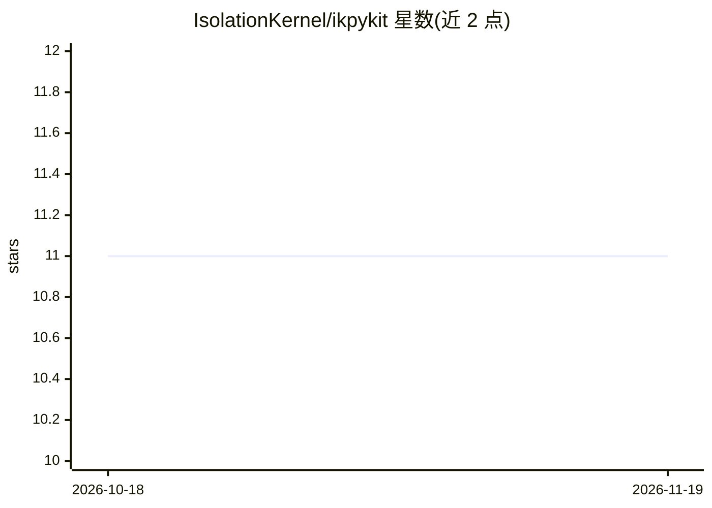

# IsolationKernel/ikpykit

⭐ 11 · Python · NOASSERTION · 推送 2026-10-31 · [GitHub](https://github.com/IsolationKernel/ikpykit) · [官网](https://isolationkernel.github.io/ikpykit/) · 组织维护

**面向 ML 任务的 Isolation Kernel Python 算法库**

IKPyKit 是实现 Isolation Kernel 的 Python 库，提供核相似度计算、异常检测、聚类与变化检测等算法，覆盖点、图、群组、流、时间序列与轨迹六类数据，共收录十余个发表于 AAAI/SIGKDD/TKDE 等会议期刊的算法（如 INNE、IForest、IsoGraphKernel、IKTOD）。接口遵循 scikit-learn API，与 scikit-learn 工具兼容。核方法为数据依赖型，无需训练或参数调优。通过 pip/uv 安装，BSD-3-Clause 许可。

## 筛选速览

| 维度 | 判定 | 备注 |
|---|---|---|
| AI 角色 | `ai-native` | 本体是模型或模型工具 |
| 许可风险 | `none` | NOASSERTION |
| 部署形态 | `library` | 以包/库形式分发 |
| 模型依赖 | — | README 未给出锁定关系 |
| 硬件要求 | — | 无带数字的原话,不猜 |
| 安装摩擦 | `low` | 无编译、无系统依赖或容器化 |
| 成熟度 | — | 结构信号不足 |

## 能力要点

- 覆盖点、图、群组、流、时间序列、轨迹六类数据的 Isolation Kernel 算法集
- 接口兼容 scikit-learn API
- 核相似度无需训练或参数调优
- 附示例、教程与 BibTeX 引用条目

## 适用场景

- 对流数据和图数据做异常检测
- 用 Isolation Kernel 计算数据分布相似度
- 对时间序列和轨迹数据做聚类与变化检测

## 场景标签

 · 领域:机器学习/数据科学

## 证据(README 行号)

> L15: **IKPyKit** (Isolation Kernel Python toolKit) is an intuitive Python library designed for a variety of machine lear
> L29: IKPyKit is specifically built to harness the power of Isolation Kernel, providing specialized algorithms for a wide
> L63: clf.predict([[0.1, 0.3], [0, 0.7], [90, 85]])

## 星数曲线

2026-10-18 11 → 2026-11-19 11（+0）

---
*卡片 v1 · prompt 1.4 · 生成 2026-11-19 · 置信度 high · 依据 README sha `17f51f859fc9` · [字段定义](../../DATASET.md)*
