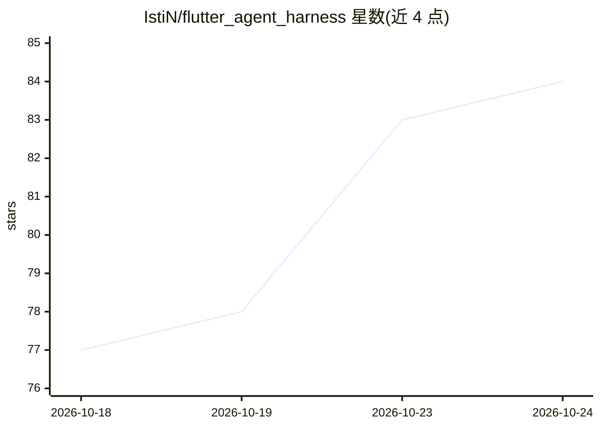

# IstiN/flutter_agent_harness

⭐ 84 · Dart · MIT · 推送 2026-10-24 · [GitHub](https://github.com/IstiN/flutter_agent_harness) · [官网](https://fa1.dev) · 个人维护

**Dart/Flutter 跨平台 AI agent 框架与终端编码代理 fa**

面向 Dart 与 Flutter 开发者的 AI agent harness：提供流式 provider 适配器（OpenAI 兼容、Anthropic、Google、Ollama、MiniMax 等）、带原生工具调用的异步 agent 循环、JSONL 会话持久化与 token 级上下文压缩；核心为纯 Dart，可运行于 VM、Flutter 桌面/移动端与 Web。附带 pi 风格终端编码代理 fa/fah（TUI 与 headless 模式），架构移植自 pi-mono。工具体系含 bash/read/write、MCP、A2A、LSP、子代理与审批门控；会话存于 ~/.fah/sessions/。通过 curl 安装脚本或 dart pub global activate 安装，另有 Web 演示与 iOS/macOS 应用。

## 筛选速览

| 维度 | 判定 | 备注 |
|---|---|---|
| AI 角色 | `ai-ecosystem` | LLM/agent 周边工具 |
| 许可风险 | `permissive` | MIT |
| 部署形态 | `None` |  |
| 模型依赖 | local-ok | 支持本地模型 |
| 硬件要求 | — | 无带数字的原话,不猜 |
| 安装摩擦 | `low` | 无编译、无系统依赖或容器化 |
| 成熟度 | — | 结构信号不足 |

## 能力要点

- 纯 Dart 核心（lib/ 无 dart:io 与 Flutter 导入），编译目标覆盖 VM/桌面/移动/Web
- 多 provider 适配：OpenAI 兼容（OpenRouter/DeepSeek/Kimi 等）、Anthropic、Google、Ollama、ChatGPT(Codex OAuth) 等
- JSONL 分支会话树 + token 级自动上下文压缩
- 工具体系：bash/read/write、MCP、A2A、LSP、并行子代理、审批门控与轨迹账本

## 适用场景

- 在 Dart/Flutter 应用中嵌入带工具调用的 AI agent 循环
- 用 fa CLI 在终端做编码/文件处理任务，支持 headless 与管道输出
- 通过审批分级与轨迹账本管控 agent 的读写与执行行为

## 场景标签

`Agent 框架` `编码 Agent` · 领域:Agent 开发

## 证据(README 行号)

> L9: Cross-platform AI agent harness for Dart and Flutter — streaming provider
> L102: - **Agent core** (`lib/src/`): the async agent loop, steering + follow-up
> L108: - **Providers**: openai-completions (covers OpenRouter/DeepSeek/Kimi/Grok/…),

## 星数曲线

2026-10-18 77 → 2026-10-24 84（+7）

---
*卡片 v1 · prompt 1.4 · 生成 2026-10-24 · 置信度 high · 依据 README sha `4e9196d59da2` · [字段定义](../../DATASET.md)*
