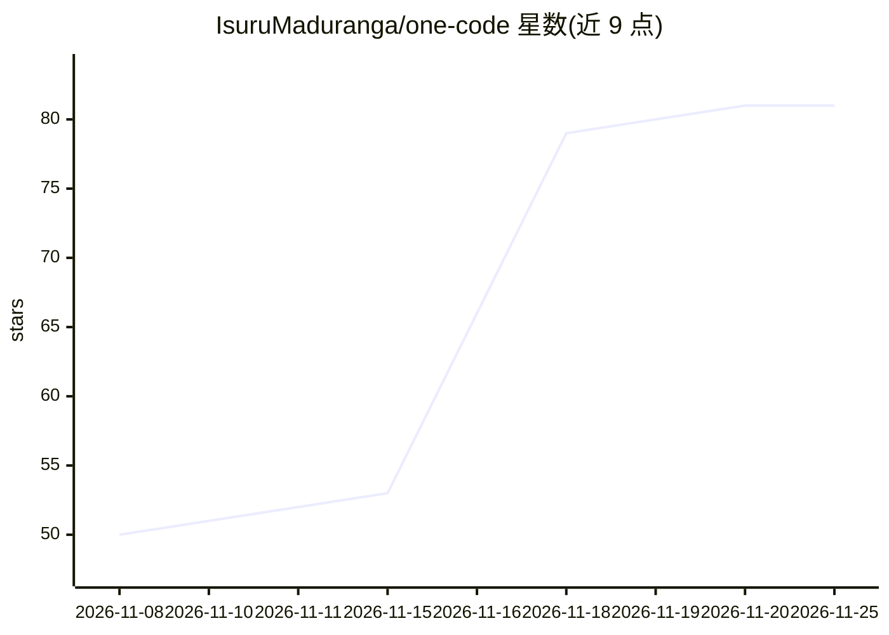

# IsuruMaduranga/one-code

⭐ 81 · TypeScript · NOASSERTION · 推送 2026-11-23 · [GitHub](https://github.com/IsuruMaduranga/one-code) · 个人维护

**模型槽开放的 Claude Code 式开源编码 agent**

基于 pi 构建的终端编码 agent，重现 Claude Code 工作流（子代理、Git worktree、auto/plan 模式、权限系统、上下文管理），但模型与提供商可自选，主代理与各子代理可分别指定模型与提供商。直接读取现有 CLAUDE.md 与 .claude/ 配置，无需导入；按四个能力等级调整提示与工具指引。依赖 Claude Code 托管或桌面服务的功能不在范围内。通过 npm 全局安装，需 Node.js 22.19+，在 macOS/Linux/Windows 验证。

## 筛选速览

| 维度 | 判定 | 备注 |
|---|---|---|
| AI 角色 | `ai-native` | 本体是模型或模型工具 |
| 许可风险 | `none` | NOASSERTION |
| 部署形态 | `library` | 以包/库形式分发 |
| 模型依赖 | locked-api |  |
| 硬件要求 | — | 无带数字的原话,不猜 |
| 安装摩擦 | `low` | 无编译、无系统依赖或容器化 |
| 成熟度 | — | 结构信号不足 |

## 能力要点

- 同一会话内为不同子代理混用不同模型与提供商
- 直接复用 CLAUDE.md、skills、commands、agents、权限规则与 MCP 配置
- 四档模型能力分级适配提示与工具指引
- ultracode 工作流以 JavaScript 脚本并行协调多代理

## 适用场景

- 在 Claude Code 工作流中改用自选模型或本地模型
- 主任务用强模型、探索与测试委托给便宜模型
- 继续沿用已有 .claude/ 配置切换工具

## 场景标签

`编码 Agent` · 领域:编码与开发

## 证据(README 行号)

> L5: **Claude Code with the model slot left open. The full workflow, open source, on any model or provider.**
> L7: One Code rebuilds the Claude Code workflow around the model you choose.
> L18: One Code is an independent, open-source implementation built on

## 星数曲线

2026-11-08 50 → 2026-11-25 81（+31）

---
*卡片 v1 · prompt 1.4 · 生成 2026-11-18 · 置信度 high · 依据 README sha `d41f3b9b18d2` · [字段定义](../../DATASET.md)*
