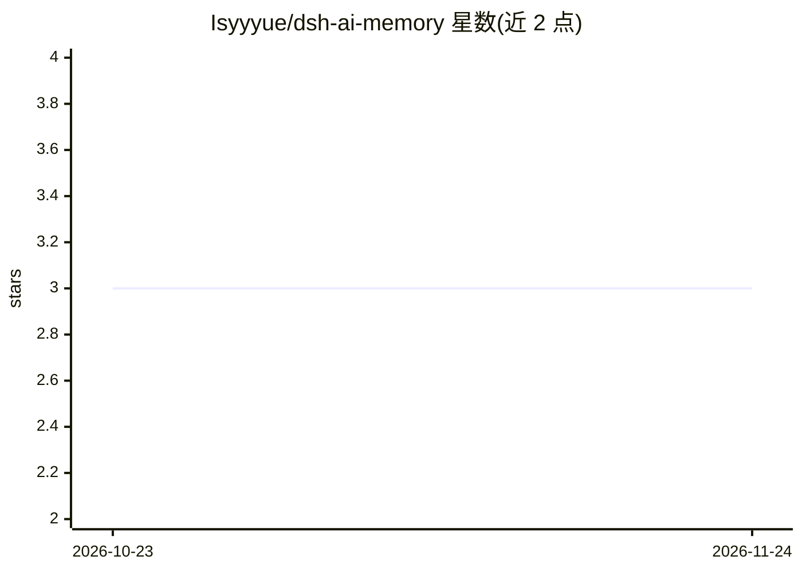

# Isyyyue/dsh-ai-memory

⭐ 3 · JavaScript · MIT · 推送 2026-10-24 · [GitHub](https://github.com/Isyyyue/dsh-ai-memory) · 个人维护 · 中文 README

**DSH 插件：为 AI 提供可审计的长期判断记忆与人格演化**

运行在 DeepSeek Harness（DSH）宿主中的插件，记录 AI 在互动中形成的判断、规则、想法与人格特征，保存为只追加的 JSONL 账本，并从中折叠出当前状态、历史与关系图谱。取代判定不计算向量相似度、不调用 LLM，只依据结构化 (subject, relation, scope) 键，被取代的记录保留不删。人格采用候选—用户确认的流程。提供 11 个 memory_* 工具。要求 Node.js 22+，运行时零外部 npm 包；数据量大后全量扫描账本需增索引。

## 筛选速览

| 维度 | 判定 | 备注 |
|---|---|---|
| AI 角色 | `ai-ecosystem` | LLM/agent 周边工具 |
| 许可风险 | `permissive` | MIT |
| 部署形态 | `None` |  |
| 模型依赖 | — | README 未给出锁定关系 |
| 硬件要求 | — | 无带数字的原话,不猜 |
| 安装摩擦 | `low` | 无编译、无系统依赖或容器化 |
| 成熟度 | — | 结构信号不足 |

## 能力要点

- 结构化键确定性取代，不调用 LLM、不计算相似度，可测试可复现
- 只追加 JSONL 账本，保留来源、修订与取代历史（bi-temporal）
- 11 个 memory_* 工具：检索、写入、关系、历史、规则、人格、反思、周期等
- 人格特征经用户确认后注入会话，候选不进入普通注入

## 适用场景

- 让 DSH 中的 AI 跨会话保留自己形成的判断及其演变原因
- 追踪某条判断为什么被推翻、什么时候变的
- 让 AI 提出表达习惯候选并经用户确认演化人格

## 场景标签

`Agent 记忆` · 领域:Agent 开发

## 证据(README 行号)

> L8: 这是一个运行在 DeepSeek Harness（DSH）中的插件，为 AI 提供可审计的长期判断记忆、未完成问题和用户确认的人格演化机制。它不是独立聊天应用，是否在无人输入时自动启动思考由 DSH 宿主调度。
> L24: 大多数 AI 记忆方案用向量相似度判断「这条新信息是不是在推翻旧的」。本插件**完全不计算相似度、不调用 LLM**，取代判定只认结构化的 `(subject, relation, scope)` 键——可测试、可复现、零延迟，而

## 星数曲线

2026-10-23 3 → 2026-11-24 3（+0）

---
*卡片 v1 · prompt 1.4 · 生成 2026-11-22 · 置信度 high · 依据 README sha `b83c5d70e996` · [字段定义](../../DATASET.md)*
