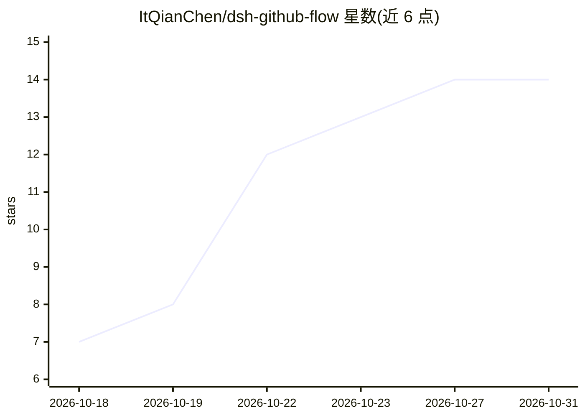

# ItQianChen/dsh-github-flow

⭐ 14 · JavaScript · MIT · 推送 2026-10-22 · [GitHub](https://github.com/ItQianChen/dsh-github-flow) · [官网](https://github.com/ItQianChen/dsh-github-flow/releases) · 个人维护 · 中文 README

**给 DeepSeek Harness Agent 提供 GitHub 操作工具的插件**

面向 DeepSeek Harness Agent（DSH）的插件，通过复用宿主机 gh CLI 凭据，为 Agent 提供 19 大领域工具（106 个 action），覆盖 PR 全生命周期、Issue 流转、Actions 构建排障、仓库免 clone 读文件、Release 发布、密钥变量管理、Agent Skills 生态、REST/GraphQL 逃生门等，并附 Slash 指令与 Web UI 全景工作台。安装依赖 DSH 插件机制与已登录的 gh CLI；写操作普遍需 confirm 二次确认，鉴权复用系统 Keyring，不使用明文 PAT。

## 筛选速览

| 维度 | 判定 | 备注 |
|---|---|---|
| AI 角色 | `ai-ecosystem` | LLM/agent 周边工具 |
| 许可风险 | `permissive` | MIT |
| 部署形态 | `library` | 以包/库形式分发 |
| 模型依赖 | locked-api |  |
| 硬件要求 | — | 无带数字的原话,不猜 |
| 安装摩擦 | `low` | 无编译、无系统依赖或容器化 |
| 成熟度 | `idea` | |

## 能力要点

- 19 大领域工具、106 个 action，覆盖 PR/Issue/Actions/Repo/Release/Secret 等
- 复用宿主机 gh CLI 登录凭据与系统 Keyring，不配置明文 PAT
- github_task 任务级原语：review_pr / diagnose_ci / prepare_release 一次调用返回裁剪结论
- log_failed 按测试框架锚点萃取失败日志块，避免整段日志进入上下文

## 适用场景

- 让 Agent 代为提交 PR、代码评审与合并
- CI 构建失败时让 Agent 定位失败步骤并修复
- 免 clone 读取远程仓库文件与跨仓代码检索
- 管理 Actions 密钥、变量与 Release 发布

## 场景标签

`代码审查` · 领域:编码与开发

## 证据(README 行号)

> L9:  让 DeepSeek Harness Agent 拥有操作 GitHub 的原生手和脚，为人机协作打造沉浸式 GitHub 工作台。
> L10:  原生复用宿主机 <code>gh</code> CLI 安全登录凭据，告别 Personal Access Token 泄露；深度打通本地 Git 工作区与云端仓库协作，兼具 19 大领域 Agent 核心工具（106 个 ac
> L44: # 场景 A：DSH 桌面版 (Desktop Profile)
> L48: dsh plugin --profile web add dsh-github-flow

## 星数曲线

2026-10-18 7 → 2026-10-31 14（+7）

---
*卡片 v1 · prompt 1.4 · 生成 2026-10-31 · 置信度 mid · 依据 README sha `0c6e69bf5f51` · [字段定义](../../DATASET.md)*
