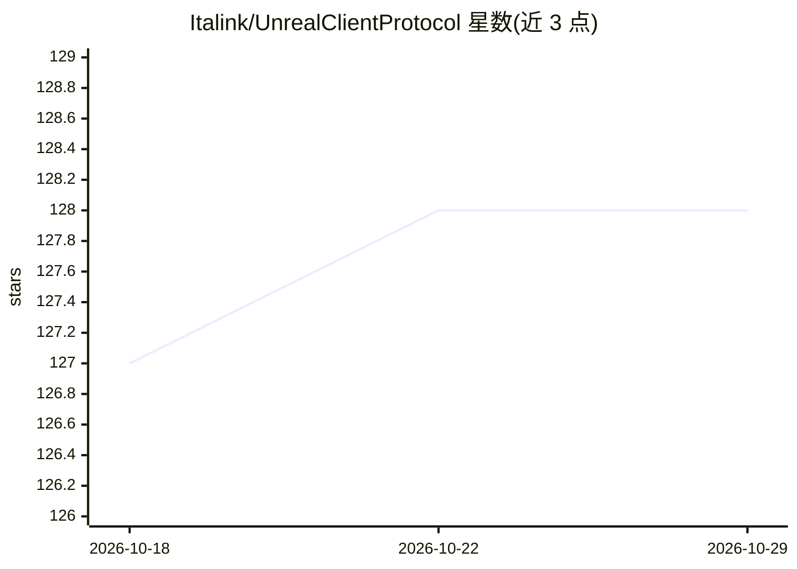

# Italink/UnrealClientProtocol

⭐ 128 · C++ · MIT · 推送 2026-08-28 · [GitHub](https://github.com/Italink/UnrealClientProtocol) · 个人维护 · 中文 README

**让 AI Agent 通过 TCP+JSON 操作 UE5 反射系统的编辑器插件**

UE5 纯插件，不改引擎源码：把引擎反射系统的原子能力（调用任意 UFunction、读写任意 UPROPERTY、查找对象、元数据内省）通过 127.0.0.1:9876 的 TCP+JSON 协议暴露给 AI Agent，仅有 call 一个命令。配套 7 个 SKILL.md 领域技能（对象、Actor、资产、材质、蓝图等），兼容 Cursor / Claude Code / OpenCode 等编码工具。引入 NodeCode 文本中间表示与 Scope 按需读取、增量 diff 机制来编辑材质与蓝图节点图。附带 Python CLI 客户端，属性写入自动接入 Undo/Redo，含回环绑定与白名单等安全控制。

## 筛选速览

| 维度 | 判定 | 备注 |
|---|---|---|
| AI 角色 | `ai-ecosystem` | LLM/agent 周边工具 |
| 许可风险 | `permissive` | MIT |
| 部署形态 | `None` |  |
| 模型依赖 | — | README 未给出锁定关系 |
| 硬件要求 | — | 无带数字的原话,不猜 |
| 安装摩擦 | `low` | 无编译、无系统依赖或容器化 |
| 成熟度 | — | 结构信号不足 |

## 能力要点

- 零引擎改动的纯插件，仅 call 命令覆盖所有可反射操作
- NodeCode 文本 IR + Scope 按需读取 + 增量 diff 编辑材质/蓝图节点图
- 7 个领域 SKILL.md，兼容 Cursor / Claude Code / OpenCode
- 属性写入接入 Undo/Redo，回环绑定与白名单安全控制

## 适用场景

- 让 AI 编码助手直接在 UE 编辑器里生成和修改材质、蓝图
- 通过 Agent 自动化场景搭建、资产管理与蓝图分析
- 为团队工作流编写自定义 Skill 注入领域规范

## 场景标签

`编码 Agent` · 领域:编码与开发

## 证据(README 行号)

> L11: UnrealClientProtocol (UCP) is an atomic client communication protocol designed for AI Agents. Its core design philo
> L15: Traditional UE automation requires writing dedicated interfaces or scripts for every operation. UCP takes the oppos
> L72: - **Multi-Tool Compatible** — Skill descriptors work with Cursor / Claude Code / OpenCode and other mainstream AI c

## 星数曲线

2026-10-18 127 → 2026-10-29 128（+1）

---
*卡片 v1 · prompt 1.4 · 生成 2026-10-23 · 置信度 high · 依据 README sha `1a5e5d0809d5` · [字段定义](../../DATASET.md)*
