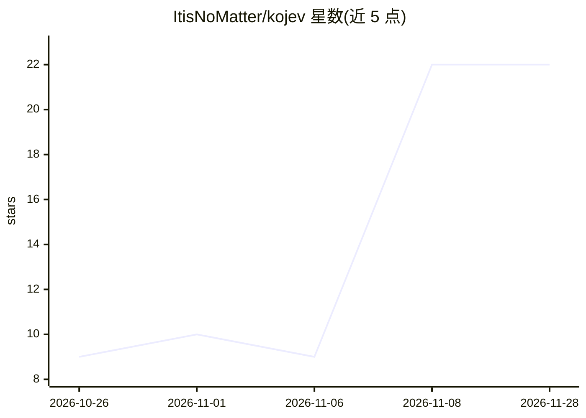

# ItisNoMatter/kojev

⭐ 22 · Kotlin · MIT · 推送 2026-10-24 · [GitHub](https://github.com/ItisNoMatter/kojev) · 个人维护

**Jev 模型的 Kotlin Multiplatform 类型安全客户端**

面向 TypeSafe AI 的 Jev 模型（System One）的第三方 Kotlin 客户端库：开发者用自定义 enum/sealed 类型定义 Choice/Score/Noul 三类问题，kojev 调用 Jev API 后以原类型返回答案，附完整概率分布、最可能值与置信度，无字符串 id 查找、无默认阈值。支持 JVM/Android/iOS 目标，通过 Gradle 依赖 Maven Central 分发，可配置 baseUrl、超时与带指数退避的重试。0.x 版本承诺遵循语义化版本但任意两次 0.x 发布间可能有破坏性变更；API key 需由服务端持有。README 同时给出与 jev4k、typesafe-sdk-kotlin 两个 Kotlin 客户端的功能对照表。

## 筛选速览

| 维度 | 判定 | 备注 |
|---|---|---|
| AI 角色 | `ai-ecosystem` | LLM/agent 周边工具 |
| 许可风险 | `permissive` | MIT |
| 部署形态 | `None` |  |
| 模型依赖 | — | README 未给出锁定关系 |
| 硬件要求 | — | 无带数字的原话,不猜 |
| 安装摩擦 | `low` | 无编译、无系统依赖或容器化 |
| 成熟度 | `idea` | |

## 能力要点

- 答案直接以用户自定义 enum 类型返回，附概率分布与置信度
- 支持 JVM、Android、iOS 三个 Multiplatform 目标
- 重试覆盖 408/429/5xx/连接错误/超时，指数退避并遵循 Retry-After
- README 代码片段被编译进构建流程，防止与 API 脱节

## 适用场景

- 在 Kotlin 多平台项目中以自定义 enum 类型调用 Jev 做决策
- 将意图分类、紧急度评分等类型化问题的领域模型共享到移动端 app 代码
- 需要概率分布而非单一文本输出的应用决策场景

## 场景标签

`模型网关` · 领域:Agent 开发

## 证据(README 行号)

> L3: A Kotlin Multiplatform client for **Jev**, TypeSafe AI's System One model. You describe the
> L63: val jev = JevClient(apiKey = System.getenv("TYPESAFE_API_KEY"), engine = CIO.create()) {

## 星数曲线

2026-10-26 9 → 2026-11-28 22（+13）

---
*卡片 v1 · prompt 1.4 · 生成 2026-11-18 · 置信度 high · 依据 README sha `36c03080f951` · [字段定义](../../DATASET.md)*
