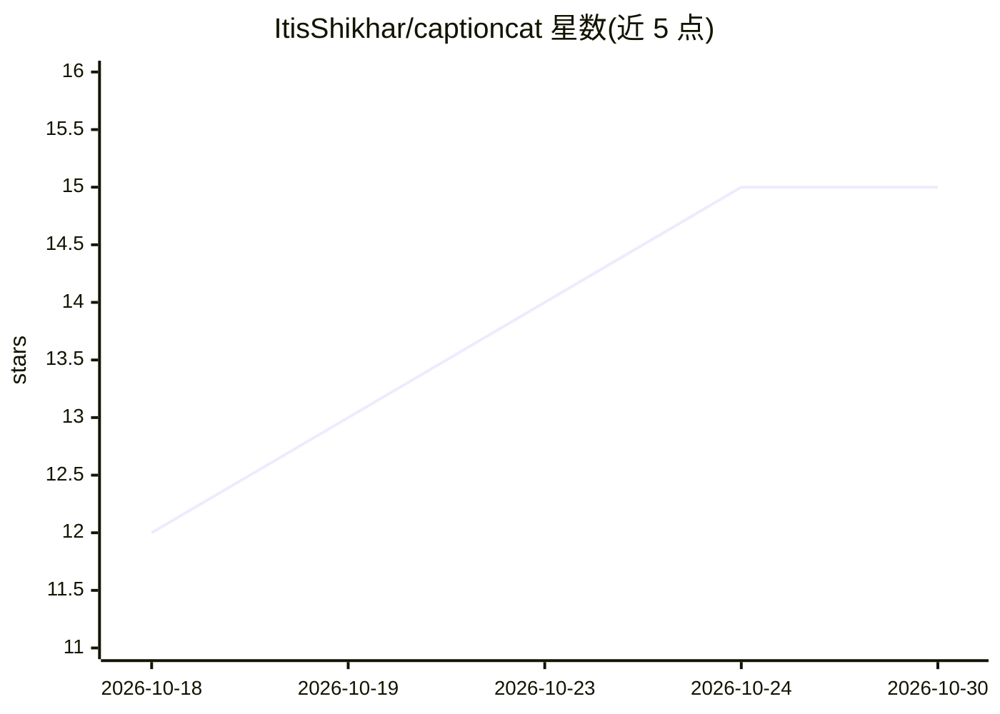

# ItisShikhar/captioncat

⭐ 15 · TypeScript · MIT · 推送 2026-09-03 · [GitHub](https://github.com/ItisShikhar/captioncat) · [官网](https://itisshikhar.github.io/captioncat/captioncat-preset-studio/) · 个人维护

**开发者用代码设计并渲染动画字幕的 Node.js 引擎**

面向开发者、创作者和 AI agent 的开源字幕引擎：以代码方式设计、动画并渲染视频/音频的视觉化字幕，通过 Skia Canvas 渲染字幕帧、FFmpeg 处理媒体合成与编码。视觉样式存储为可复用 JSON 预设（内置 36 个），支持多语言（LTR/RTL）、多种输出（带字幕视频、独立字幕影片、PNG 序列、ASS/SRT/VTT/JSON）。未提供字幕时可调用 OpenAI、EleLabs、Sarvam 等转录服务直接从媒体转写。附单文件 HTML 版 Preset Studio 可视化预设编辑器与全局 CLI。要求 Node.js 22.0.0+，npm 包内含 FFmpeg 二进制与 Skia Canvas。

## 筛选速览

| 维度 | 判定 | 备注 |
|---|---|---|
| AI 角色 | `ai-native` | 本体是模型或模型工具 |
| 许可风险 | `permissive` | MIT |
| 部署形态 | `library` | 以包/库形式分发 |
| 模型依赖 | — | README 未给出锁定关系 |
| 硬件要求 | — | 无带数字的原话,不猜 |
| 安装摩擦 | `medium` | 含编译或系统依赖之一 |
| 成熟度 | — | 结构信号不足 |

## 能力要点

- Skia Canvas + FFmpeg 的渲染管线，服务端渲染无需浏览器/DOM
- 字幕样式以 ECS 预设存储为可复用 JSON，内置 36 个预设
- 支持 OpenAI、ElevenLabs、Sarvam 转录服务，按优先级自动回退
- Preset Studio 单文件 HTML 可视化编辑器与全局 CLI

## 适用场景

- 为短视频批量生成带动画效果的视觉化字幕
- 复用 JSON 预设统一团队作品的字幕风格
- 无现成字幕文件时直接从视频/音频转写并渲染字幕
- 导出 ASS/SRT/VTT 字幕文件供其他工具使用

## 场景标签

`图像视频处理` · 领域:感知与多模态

## 证据(README 行号)

> L27: **captioncat is an open-source engine for designing, animating, and rendering expressive captions for videos and au
> L89: - **AI-ready** - Transcribe directly from video or audio using supported transcription providers like OpenAI, Eleve
> L317: 3. Render caption frames with Skia Canvas.

## 星数曲线

2026-10-18 12 → 2026-10-30 15（+3）

---
*卡片 v1 · prompt 1.4 · 生成 2026-10-30 · 置信度 high · 依据 README sha `0eac2823c77c` · [字段定义](../../DATASET.md)*
