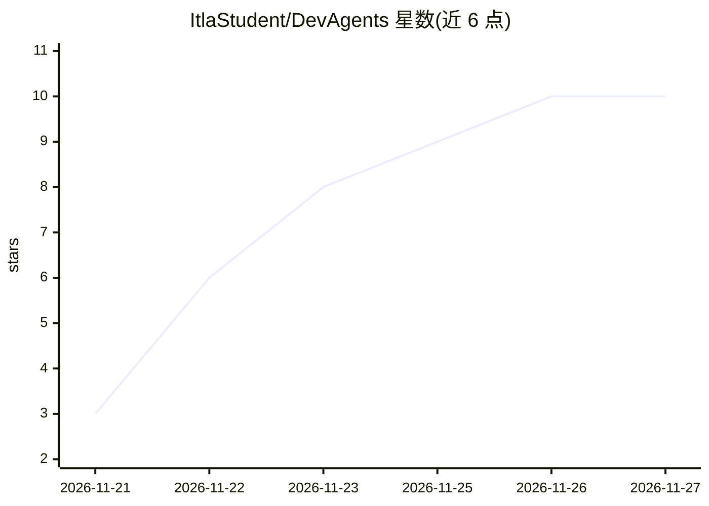

# ItlaStudent/DevAgents

⭐ 10 · C · Apache-2.0 · 推送 2026-11-25 · [GitHub](https://github.com/ItlaStudent/DevAgents) · [官网](https://4stra.dev/devagents) · 个人维护

**多模型多智能体开发编排环境：带预算与可审计治理**

一个 beta 阶段的开源智能体开发环境（ADE），提供图形应用、引擎、CLI 与 MCP 服务器。支持 Direct（单模型对话）、Orchestrated（任务分发与跨供应商审计）、Hive（多模型分工构建与审计）、Best of N 等模式；治理层组合外部审计、引用检查、预算与命令策略，无审计结论时阻止交付。文档注明尚无已发布二进制，需从源码构建；图形界面仅限 64 位 Windows，Linux 上引擎/CLI/MCP 处于 beta。

## 筛选速览

| 维度 | 判定 | 备注 |
|---|---|---|
| AI 角色 | `ai-ecosystem` | LLM/agent 周边工具 |
| 许可风险 | `permissive` | Apache-2.0 |
| 部署形态 | `desktop` | 安装包/桌面程序 |
| 模型依赖 | local-ok | 支持本地模型 |
| 硬件要求 | — | 无带数字的原话,不猜 |
| 安装摩擦 | `low` | 无编译、无系统依赖或容器化 |
| 成熟度 | `idea` | |

## 能力要点

- Direct/Orchestrated/Hive/Best of N 多种多模型编排模式
- 治理层：外部供应商审计、引用检查、预算与命令策略，无审计则阻止交付
- MCP 服务器暴露 121 个工具，支持 stdio 与版本协商
- 可接入 Ollama 本地模型及 Claude Code/Codex/Gemini CLI/OpenCode 外部 CLI

## 适用场景

- 在同一开发环境中分发任务给多个模型并保留审计记录
- 用本地模型（Ollama）配合 API 供应商执行开发订单
- 通过 MCP 从外部 IDE 调用文件、终端、Git、计划等工具

## 场景标签

`多智能体` `编码 Agent` · 领域:Agent 开发

## 证据(README 行号)

> L5: **DevAgents is a free, open-source agentic development environment (ADE) in beta.** The graphical app is for 64-bit 
> L9: DevAgents — multi-agent orchestrator, local and verifiable
> L33: |**Native MCP and CLI**|`devagents-mcp.exe` over stdio; `devagents.exe` aliases `devagents-core.exe`. MCP exposes 1

## 星数曲线

2026-11-21 3 → 2026-11-27 10（+7）

---
*卡片 v1 · prompt 1.4 · 生成 2026-11-22 · 置信度 high · 依据 README sha `e80f157c324b` · [字段定义](../../DATASET.md)*
