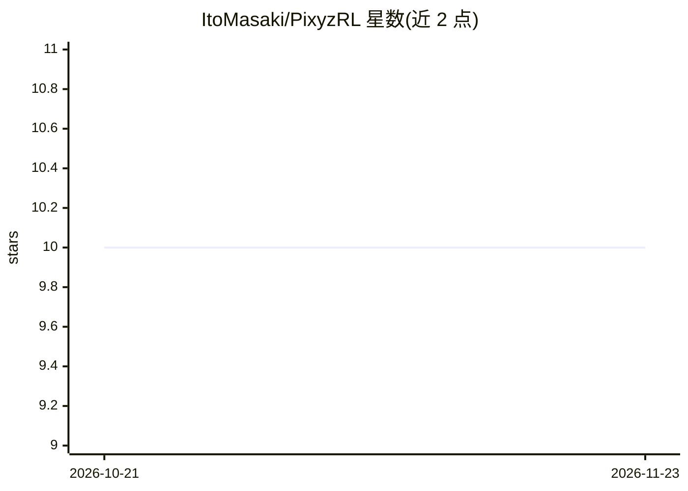

# ItoMasaki/PixyzRL

⭐ 10 · Python · MIT · 推送 2026-03-16 · [GitHub](https://github.com/ItoMasaki/PixyzRL) · 个人维护

**基于概率生成模型与贝叶斯理论的强化学习框架**

PixyzRL 是构建在 Pixyz 库之上的强化学习框架，以概率生成模型和贝叶斯理论为基础，用于不确定性感知的决策与提升样本效率。提供 PPO、A2C、SAC、DQN 等算法实现，支持 on-policy/off-policy 学习、Replay/Rollout Buffer、MC/GAE/GRPO 优势计算，并与 Gymnasium 环境集成；策略分布可输出为 LaTeX 形式。安装方式为 pip 或源码构建，依赖 Python 3.10+、PyTorch 2.5.1+ 与 Gymnasium。

## 筛选速览

| 维度 | 判定 | 备注 |
|---|---|---|
| AI 角色 | `ai-native` | 本体是模型或模型工具 |
| 许可风险 | `permissive` | MIT |
| 部署形态 | `library` | 以包/库形式分发 |
| 模型依赖 | — | README 未给出锁定关系 |
| 硬件要求 | — | 无带数字的原话,不猜 |
| 安装摩擦 | `low` | 无编译、无系统依赖或容器化 |
| 成熟度 | — | 结构信号不足 |

## 能力要点

- 实现 PPO/A2C/SAC/DQN 等强化学习算法
- 支持 MC/GAE/GRPO 优势计算与 Replay/Rollout Buffer
- 与 Gymnasium 环境集成，附 CartPole、CarRacing 等示例脚本
- 基于 Pixyz 库，策略分布可打印为 LaTeX 表达式

## 适用场景

- 训练连续控制任务的智能体（如 Pendulum、BipedalWalker）
- 在离散/连续动作环境中运行 PPO 或 SAC 实验
- 以概率生成模型形式构建和查看 RL 策略结构

## 场景标签

`强化学习` · 领域:训练与推理

## 证据(README 行号)

> L17: **PixyzRL** is a reinforcement learning (RL) framework based on **probabilistic generative models** and **Bayesian 
> L18: - **Probabilistic Policy Optimization** (e.g., PPO, A2C)

## 星数曲线

2026-10-21 10 → 2026-11-23 10（+0）

---
*卡片 v1 · prompt 1.4 · 生成 2026-11-20 · 置信度 high · 依据 README sha `5dd95ecab552` · [字段定义](../../DATASET.md)*
