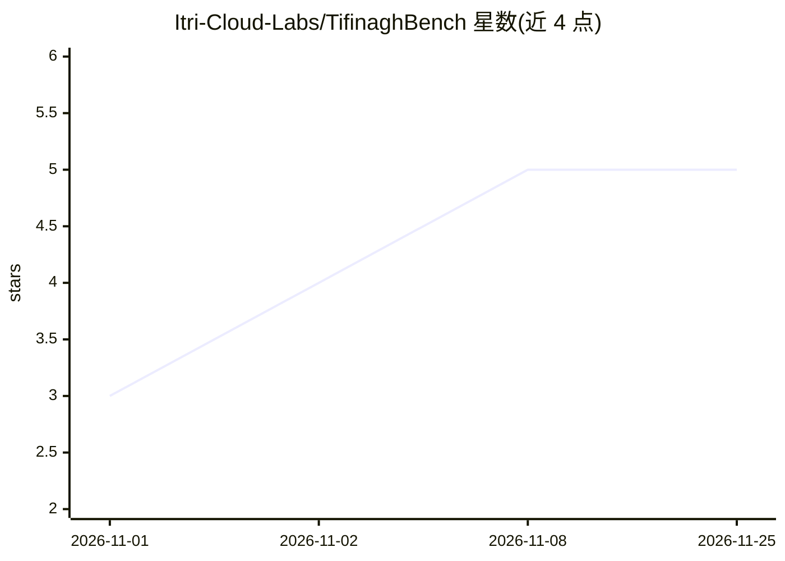

# Itri-Cloud-Labs/TifinaghBench

⭐ 5 · TypeScript · MIT · 推送 2026-11-21 · [GitHub](https://github.com/Itri-Cloud-Labs/TifinaghBench) · 组织维护

**用编程 Agent 测评 LLM 提夫纳尔文阿马齐格语词汇的基准**

tifinagh-bench 以约 27,000 条词典条目向 LLM 提出三语（摩洛哥标准阿马齐格语、塔里菲特语、卡拜尔语）闭卷词汇题，任务覆盖提夫纳尔文↔英语与↔拉丁转写。复用 Codex、Claude Code、OpenCode、Pi 等编程 Agent 作为运行通道，禁用工具与网络检索，按批次答题控制订阅成本，以 LLM 评委给自由释义打分并记录字符错误率，随机种子保证可复现，结果发布到静态排行榜网站。数据集因版权许可尚未发布，需自备。

## 筛选速览

| 维度 | 判定 | 备注 |
|---|---|---|
| AI 角色 | `ai-ecosystem` | LLM/agent 周边工具 |
| 许可风险 | `permissive` | MIT |
| 部署形态 | `library` | 以包/库形式分发 |
| 模型依赖 | — | README 未给出锁定关系 |
| 硬件要求 | — | 无带数字的原话,不猜 |
| 安装摩擦 | `low` | 无编译、无系统依赖或容器化 |
| 成熟度 | `idea` | |

## 能力要点

- 约 27,000 条词典条目、3 种方言 × 3 类任务的闭卷词汇评测
- 复用 Codex/Claude Code/OpenCode/Pi 等 Agent 作为测试通道并禁用工具保证闭卷
- LLM 评委打分 + 同义/同形词宽容 + 字符错误率，种子可控可断点续跑
- 0–100 总分按 3 方言 × 2 任务等权平均，转写单列

## 适用场景

- 比较不同 LLM 对提夫纳尔文阿马齐格语词汇的掌握程度
- 为低资源语言评测搭建基于编程 Agent 的批量答题流水线
- 查阅已发布运行结果的公开排行榜

## 场景标签

`模型评测` · 领域:评测与运维

## 证据(README 行号)

> L5: tifinagh-bench asks models closed-book vocabulary questions in three Amazigh dialects, using about 27,000 dictionary
> L31: - **Closed-book.** Tools, web search and user/project instructions are disabled in every harness, and each session 
> L33: - **Fair scoring.** Synonyms and homonyms in the dictionary are all accepted. Free-text meanings are graded by an L

## 星数曲线

2026-11-01 3 → 2026-11-25 5（+2）

---
*卡片 v1 · prompt 1.4 · 生成 2026-11-21 · 置信度 high · 依据 README sha `bfb7cf2e69c2` · [字段定义](../../DATASET.md)*
