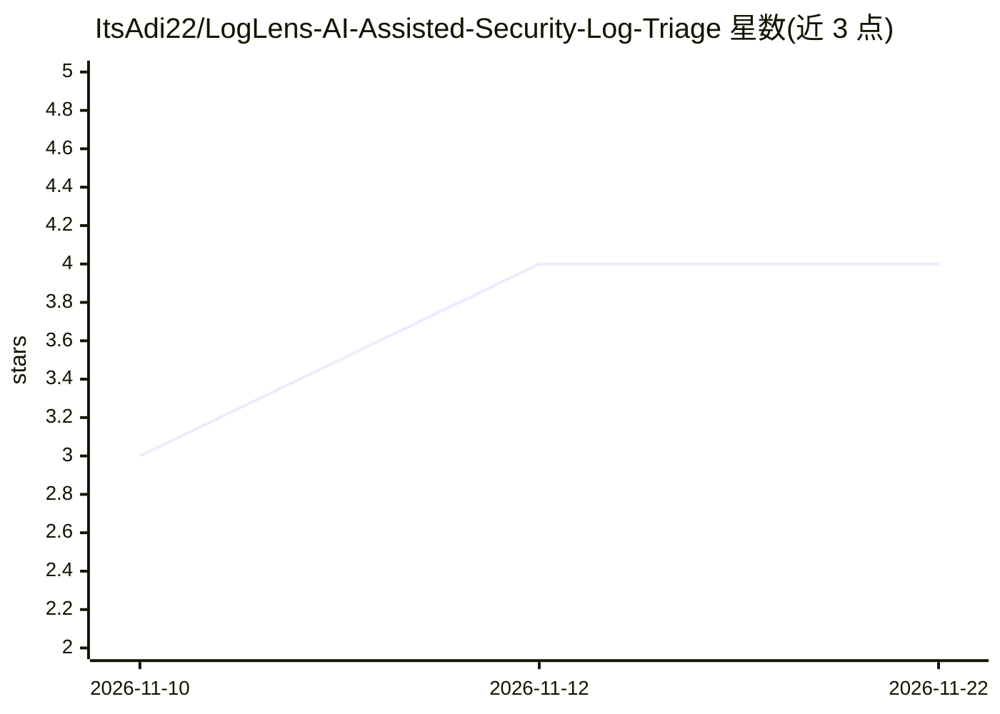

# ItsAdi22/LogLens-AI-Assisted-Security-Log-Triage

⭐ 4 · Python · Apache-2.0 · 推送 2026-11-10 · [GitHub](https://github.com/ItsAdi22/LogLens-AI-Assisted-Security-Log-Triage) · 个人维护

**面向自托管运维的本地 AI 安全日志分诊工具**

LogLens 读取系统与 Web 日志，先用 Drain3 将日志压缩为签名模板，再匹配 18+ 条 MITRE ATT&CK 确定性规则，可选地将脱敏后的聚类摘要交给本地 LLM（Ollama）或云厂商，用于解释事件、评估严重度并给出处置建议。默认完全离线运行，内置可逆脱敏（IP/邮箱/JWT/AWS 凭据）、提示注入防护边界、Telegram/Discord/Webhook 告警与 MD/JSON/HTML 报告，提供 CLI 与 FastAPI Web 面板。无 LLM 时可 --no-llm 纯规则模式运行。

## 筛选速览

| 维度 | 判定 | 备注 |
|---|---|---|
| AI 角色 | `ai-enhanced` | 去掉 AI 部分产品仍成立 |
| 许可风险 | `permissive` | Apache-2.0 |
| 部署形态 | `self-host` | docker 或自建部署 |
| 模型依赖 | local-ok | 支持本地模型 |
| 硬件要求 | — | 无带数字的原话,不猜 |
| 安装摩擦 | `low` | 无编译、无系统依赖或容器化 |
| 成熟度 | — | 结构信号不足 |

## 能力要点

- Drain3 模板聚类：5 万行日志压缩为约 14 个模板，降低 LLM token 消耗
- 18+ MITRE ATT&CK YAML 确定性规则，支持 --no-llm 纯离线模式
- 可逆脱敏与提示注入防护（边界标签隔离、LLM 无工具/无网络出口）
- 支持 Telegram/Discord/Webhook 告警与 MD/JSON/HTML 报告输出

## 适用场景

- 自托管服务器上离线分诊 sshd/nginx 等安全日志
- 在不上传日志数据的前提下用本地 LLM 解释安全事件
- 对接 Telegram/Discord/Webhook 做去重告警
- 通过 MITRE 规则批量识别攻击模式

## 场景标签

`网络安全` · 领域:学习与行业

## 证据(README 行号)

> L11: LogLens transforms noisy security logs into structured, high-confidence forensic intelligence. It ingests system an
> L62: ### 2. Analyze Logs in Rule-Only Offline Mode (Zero LLM setup required)

## 星数曲线

2026-11-10 3 → 2026-11-22 4（+1）

---
*卡片 v1 · prompt 1.4 · 生成 2026-11-21 · 置信度 high · 依据 README sha `b3a089dc2000` · [字段定义](../../DATASET.md)*
