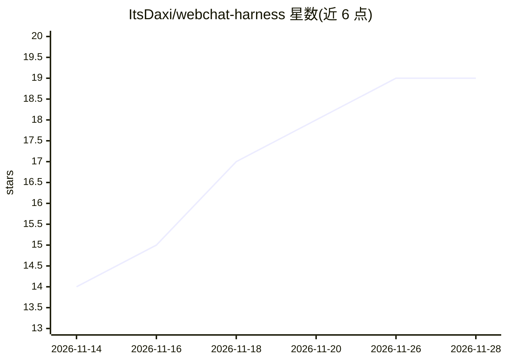

# ItsDaxi/webchat-harness

⭐ 19 · JavaScript · MIT · 推送 2026-11-15 · [GitHub](https://github.com/ItsDaxi/webchat-harness) · 个人维护

**让 DeepSeek/Qwen 网页聊天直接操作本机文件的浏览器扩展**

非官方 Chromium 扩展，为网页版 AI 聊天（当前支持 DeepSeek 与 Qwen）注入工具能力：读取/编辑所选文件夹中的文件、项目内搜索、执行 shell 命令，卡片形式展示并默认需用户逐项批准，附带 diff。任务列表跟踪进度，可读取图片/PDF/Office 文档，并接入已有 MCP 服务器的工具；长搜索可交给后台辅助聊天。无需 API key，依赖网页结构，站点更新可能导致失效。

## 筛选速览

| 维度 | 判定 | 备注 |
|---|---|---|
| AI 角色 | `ai-ecosystem` | LLM/agent 周边工具 |
| 许可风险 | `permissive` | MIT |
| 部署形态 | `None` |  |
| 模型依赖 | locked-api |  |
| 硬件要求 | — | 无带数字的原话,不猜 |
| 安装摩擦 | `low` | 无编译、无系统依赖或容器化 |
| 成熟度 | — | 结构信号不足 |

## 能力要点

- 为网页版聊天注入文件读写、项目搜索与 shell 命令执行能力
- 默认逐项批准并展示 diff，可按文件夹放宽权限
- 支持读取图片、PDF、Office 文档及已有 MCP 服务器工具
- 无需 API key，控件直接嵌入聊天页面

## 适用场景

- 不配 API key 就让网页版 DeepSeek/Qwen 充当本机编程助手
- 在既有聊天界面上对本地项目做搜索与编辑
- 通过后台辅助聊天执行长搜索任务

## 场景标签

`编码 Agent` · 领域:编码与开发

## 证据(README 行号)

> L3: A browser extension that lets the AI chat you already use on a website work on your computer: read and edit your fil
> L5: Currently supported: DeepSeek and Qwen. More chat sites are planned.
> L9: You write to the chat as usual. When the AI needs to look at a file, change some code or run a command, a card appea

## 星数曲线

2026-11-14 14 → 2026-11-28 19（+5）

---
*卡片 v1 · prompt 1.4 · 生成 2026-11-18 · 置信度 high · 依据 README sha `a03e6aa1316c` · [字段定义](../../DATASET.md)*
