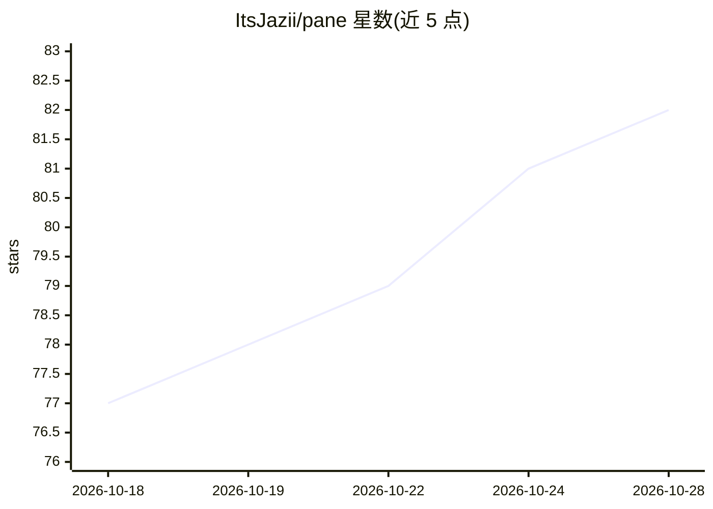

# ItsJazii/pane

⭐ 82 · Rust · NOASSERTION · 推送 2026-10-26 · [GitHub](https://github.com/ItsJazii/pane) · [官网](https://trypane.xyz) · 个人维护 · 中文 README

**Windows 托盘应用：统一查看 25+ AI 订阅的额度与花费**

基于 Tauri v2（Rust 核心 + TypeScript UI）的 Windows 系统托盘应用，追踪 Claude、Codex、Cursor、Copilot、Kimi、Grok 等 25 个 AI 服务商的订阅限额、会话窗口、余额与重置时间。机制：读取本机 CLI/编辑器已保存的登录凭据文件或用户粘贴的 API key，每隔几分钟向各厂商自有的 usage API 查询；扫描本地 CLI 请求日志，按 LiteLLM/models.dev 实时费率计算美元花费并绘制 Today/30 天环形图。数据留在本机，无账号体系；提供额度消耗速度预测与 Windows 通知。安装支持 winget、PowerShell 脚本与 .exe 安装包。

## 筛选速览

| 维度 | 判定 | 备注 |
|---|---|---|
| AI 角色 | `ai-ecosystem` | LLM/agent 周边工具 |
| 许可风险 | `none` | NOASSERTION |
| 部署形态 | `desktop` | 安装包/桌面程序 |
| 模型依赖 | local-ok | 支持本地模型 |
| 硬件要求 | — | 无带数字的原话,不猜 |
| 安装摩擦 | `low` | 无编译、无系统依赖或容器化 |
| 成熟度 | — | 结构信号不足 |

## 能力要点

- 读取本机 CLI 凭据文件（如 Claude Code、Codex CLI）自动发现账户，多账户各得一卡
- 扫描本地 CLI 请求日志，用 LiteLLM/models.dev 实时费率计算美元/Token 花费
- 各重置窗口内的消耗速度预测与『将耗尽』托盘通知
- 支持 25 个服务商，Claude/Codex 可赎回累积的 Rate Limit Reset 信用

## 适用场景

- 在托盘一眼查看多个 AI 订阅还剩多少额度、何时重置
- 估算各 AI 工具按 API 价折算的每日/30 天花费
- 额度将耗尽前收到预警通知，避免任务中途撞墙

## 场景标签

 · 领域:AI 工具使用监控/桌面工具

## 证据(README 行号)

> L112: **2. Asking the vendors.** Every few minutes, each provider's token is sent
> L142: **5. Staying local.** All of the above happens on your machine. There is

## 星数曲线

2026-10-18 77 → 2026-10-28 82（+5）

---
*卡片 v1 · prompt 1.4 · 生成 2026-10-24 · 置信度 mid · 依据 README sha `ee42b0415a05` · [字段定义](../../DATASET.md)*
