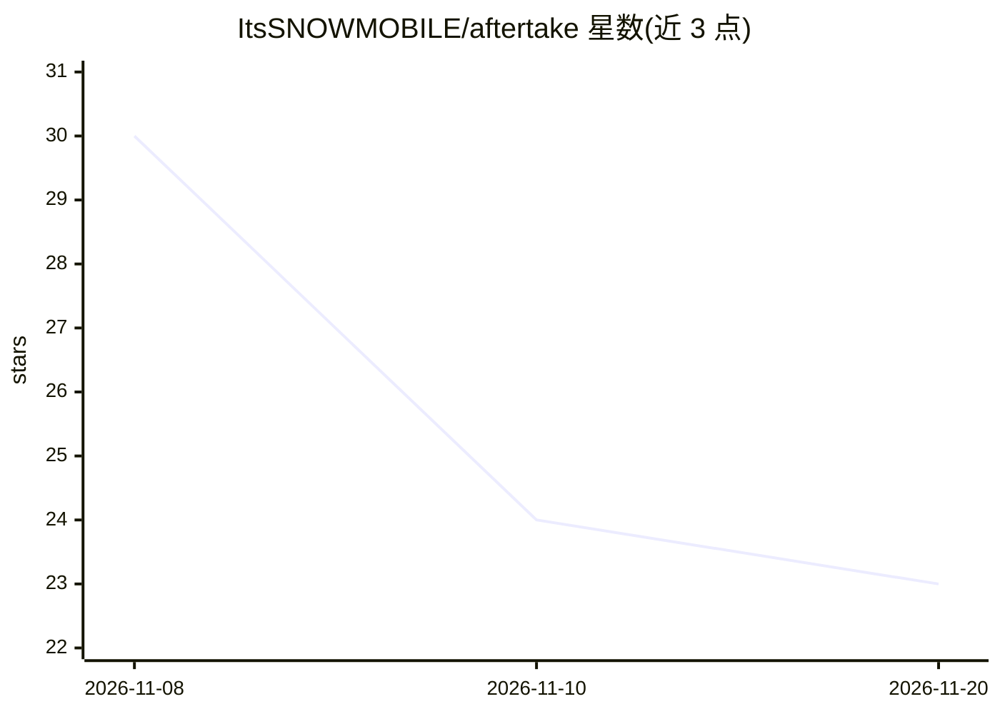

# ItsSNOWMOBILE/aftertake

⭐ 23 · TypeScript · MIT · 推送 2026-10-30 · [GitHub](https://github.com/ItsSNOWMOBILE/aftertake) · [官网](https://itssnowmobile.github.io/aftertake/) · 个人维护

**在本地 GPU 上生成、重铸与剪辑视频的开源 AI 视频工作室**

面向希望在本机产出视频内容的创作者：通过 ComfyUI 工作流调用 LTX-2.5、Z-Image Turbo、SAM3、SeedVR2 等开放权重模型，提供文生视频、人物替换、区域特效、放大、插帧、配乐等功能，并内置节拍剪辑的 Film 编辑器与 55 个工具的 MCP 服务供 agent 调用。本地运行，无积分与封闭 API；无 NVIDIA GPU 的生成任务可选付费 Comfy Cloud 逐工作室替代。生成结果仍需人工核查。

## 筛选速览

| 维度 | 判定 | 备注 |
|---|---|---|
| AI 角色 | `ai-native` | 本体是模型或模型工具 |
| 许可风险 | `permissive` | MIT |
| 部署形态 | `library` | 以包/库形式分发 |
| 模型依赖 | — | README 未给出锁定关系 |
| 硬件要求 | — | 无带数字的原话,不猜 |
| 安装摩擦 | `medium` | 含编译或系统依赖之一 |
| 成熟度 | `idea` | |

## 能力要点

- 文生视频（含声音）、图像生成、角色替换、运动迁移、×2 放大等 11 类模型档案
- MCP 服务暴露 55 个工具，agent 可生成、跟踪、增强与导出
- 编辑与导出在 CPU 运行，无需 GPU；生成任务按档案选择性启用 NVIDIA GPU
- 每次任务保留请求、种子、内容哈希与实际执行的 ComfyUI 图

## 适用场景

- 在本地 GPU 上从文本提示生成带音轨的产品视频
- 跟踪并替换实拍素材中的人物或迁移动作
- 用节拍检测把剪辑点对齐音乐完成成片
- 通过 MCP 让自己的 agent 驱动整套视频生成与导出流程

## 场景标签

`视频生成` `图像生成` · 领域:内容生成

## 证据(README 行号)

> L3:  The open-source AI video studio that runs on your own machine.
> L5: Generate shots, recast characters, paint effects onto real footage and cut the
> L6: final film in one local workspace, using open-weight models and native ComfyUI

## 星数曲线

2026-11-08 30 → 2026-11-20 23（-7）

---
*卡片 v1 · prompt 1.4 · 生成 2026-11-18 · 置信度 high · 依据 README sha `7947caa61f6a` · [字段定义](../../DATASET.md)*
