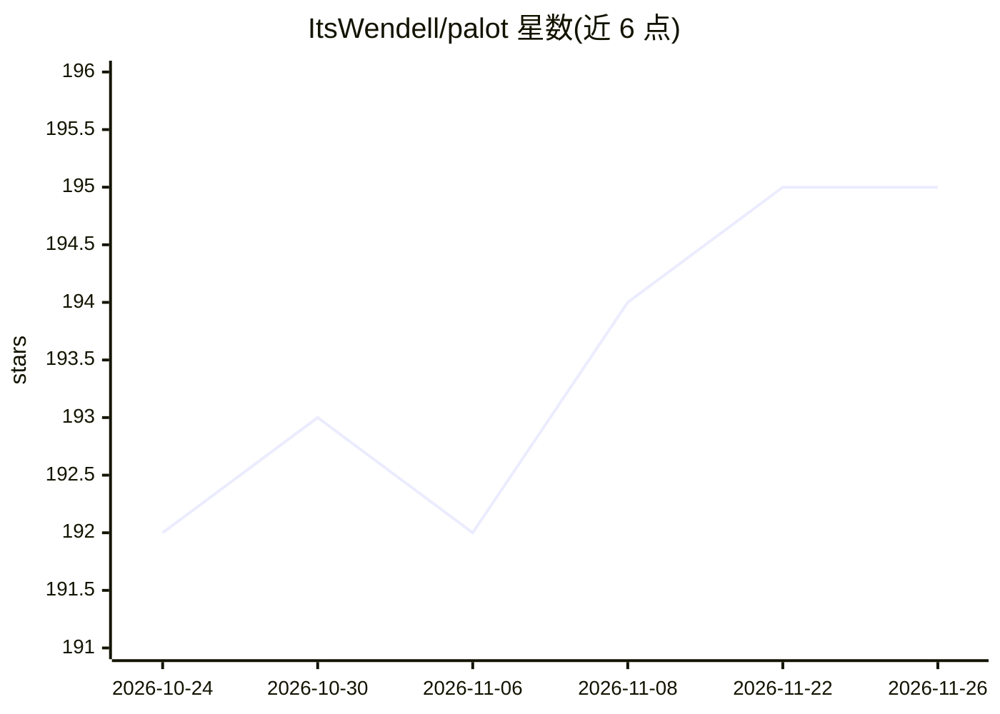

# ItsWendell/palot

⭐ 195 · TypeScript · MIT · 推送 2026-11-25 · [GitHub](https://github.com/ItsWendell/palot) · 个人维护

**为 OpenCode 2 提供桌面客户端，管理会话与并行代理**

面向 Linux 与 macOS 的 OpenCode 2 第三方桌面客户端，非官方项目。以 OpenCode 为项目、会话、消息与工具执行的源头，桌面端提供跨会话操作界面、活动与代码变更审查、请求处理及本地 OpenCode 连接管理。0.24.0 引入统一任务列表、单字段编辑器、从提交到 PR 的 ship 按钮与用量页。桌面打包目标为 Linux x64 与 macOS Apple Silicon，安装包为实验性质，更新需手动，0.12.0 起仅源码发布。

## 筛选速览

| 维度 | 判定 | 备注 |
|---|---|---|
| AI 角色 | `ai-ecosystem` | LLM/agent 周边工具 |
| 许可风险 | `permissive` | MIT |
| 部署形态 | `desktop` | 安装包/桌面程序 |
| 模型依赖 | — | README 未给出锁定关系 |
| 硬件要求 | — | 无带数字的原话,不猜 |
| 安装摩擦 | `low` | 无编译、无系统依赖或容器化 |
| 成熟度 | `idea` | |

## 能力要点

- 跨会话任务列表与键盘分诊（0.24.0）
- ship 按钮：从提交到受监控的 PR 并回传失败检查供 agent 修复
- 支持本地 OpenCode 服务的启动、恢复与通道管理
- 不含遥测或崩溃上报

## 适用场景

- 在桌面上管理多个 OpenCode 编码会话与并行 agent
- 审查 agent 产生的代码变更与 PR 状态
- 通过任务列表处理 agent 的请求与跟进

## 场景标签

`编码 Agent` · 领域:编码与开发

## 证据(README 行号)

> L5: Palot is an independent desktop client for OpenCode 2 on Linux and macOS. It is not
> L10: models, and tool execution. The desktop app adds a focused interface for
> L9: Palot keeps OpenCode as the source of truth for projects, sessions, messages,

## 星数曲线

2026-10-24 192 → 2026-11-26 195（+3）

---
*卡片 v1 · prompt 1.4 · 生成 2026-11-26 · 置信度 high · 依据 README sha `ad8cd9931c87` · [字段定义](../../DATASET.md)*
