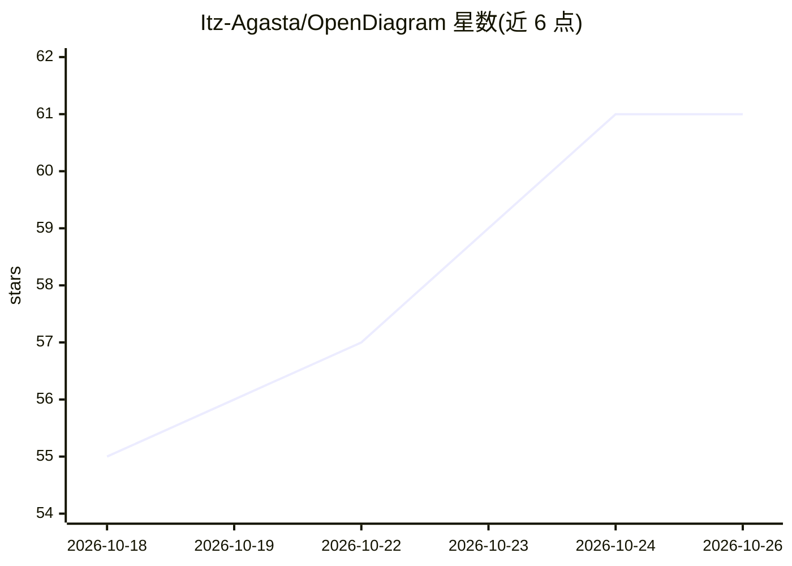

# Itz-Agasta/OpenDiagram

⭐ 61 · TypeScript · AGPL-3.0 · 推送 2026-10-23 · [GitHub](https://github.com/Itz-Agasta/OpenDiagram) · [官网](https://opendiagram.ink) · 个人维护

**自然语言生成可编辑软件架构图的 AI 工具，可自托管**

面向工程师的 AI 架构图生成器：输入英文描述，AI agent 生成类型化 DiagramSpec，由 ELK 布局引擎与主题渲染器输出到 Excalidraw 画布，支持系统设计、时序图、ERD、流程图与云架构图（AWS/GCP/Kubernetes 图标）。提供对话式迭代、跨会话项目记忆、GitHub 仓库导入与访客模式。自带 API key 接入 OpenAI/Anthropic/Google/OpenRouter，AGPL-3.0 开源可自托管，需 Bun 1.3+ 与 PostgreSQL，从源码部署。

## 筛选速览

| 维度 | 判定 | 备注 |
|---|---|---|
| AI 角色 | `ai-native` | 本体是模型或模型工具 |
| 许可风险 | `viral` | AGPL-3.0 |
| 部署形态 | `None` |  |
| 模型依赖 | locked-api |  |
| 硬件要求 | — | 无带数字的原话,不猜 |
| 安装摩擦 | `low` | 无编译、无系统依赖或容器化 |
| 成熟度 | — | 结构信号不足 |

## 能力要点

- LLM 输出类型化 DiagramSpec，布局与渲染由确定性引擎（ELK）负责，不输出 Mermaid
- 图落地为原生 Excalidraw 元素，可继续编辑、套用 Sketch/Classic 两种主题
- 支持 OpenAI/Anthropic/Google/OpenRouter 自带 key，按项目选模型，密钥加密存储
- 项目上下文与设计决策跨会话持久化，agent 可提问澄清并自我纠错

## 适用场景

- 用一句英文描述生成微服务/云架构图并继续手工调整
- 在自托管环境中生成和迭代系统设计、时序、ERD 图
- 团队在同一工作区维护设计文档与图的演进记录

## 场景标签

 · 领域:开发者工具/图表生成

## 证据(README 行号)

> L7:  Describe your system in plain English. Get editable architecture, sequence, ERD and cloud diagrams on a real Excali
> L31: OpenDiagram is a free, open-source **AI diagram generator** built for engineers. Type a prompt like _"Design a micr

## 星数曲线

2026-10-18 55 → 2026-10-26 61（+6）

---
*卡片 v1 · prompt 1.4 · 生成 2026-10-24 · 置信度 high · 依据 README sha `062d4dddd1e1` · [字段定义](../../DATASET.md)*
