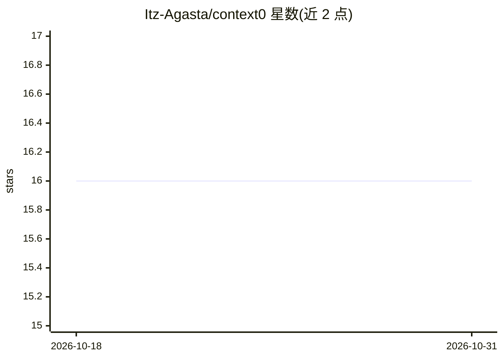

# Itz-Agasta/context0

⭐ 16 · TypeScript · MIT · 推送 2026-04-12 · [GitHub](https://github.com/Itz-Agasta/context0) · [官网](https://context0-liard.vercel.app) · 个人维护

**去中心化 AI agent 记忆共享协议：记忆存 Arweave 区块链**

面向 AI agent 的记忆存储与共享协议，由四层组成：EizenDB（运行在 Arweave 区块链上的向量数据库，HNSW 算法、Protocol Buffer 编码）、RESTful API（本地 Xenova 生成嵌入）、MCP Server（向 Claude、Cursor 等 agent 提供 store_memory/search_memory 工具）和 Next.js 客户端面板。记忆以客户端加密方式存储在 Arweave 合约中，支持跨平台语义检索。提供 git clone + docker-compose 本地部署方式；SDK 集成标注为 Soon。

## 筛选速览

| 维度 | 判定 | 备注 |
|---|---|---|
| AI 角色 | `ai-ecosystem` | LLM/agent 周边工具 |
| 许可风险 | `permissive` | MIT |
| 部署形态 | `self-host` | docker 或自建部署 |
| 模型依赖 | — | README 未给出锁定关系 |
| 硬件要求 | — | 无带数字的原话,不猜 |
| 安装摩擦 | `low` | 无编译、无系统依赖或容器化 |
| 成熟度 | — | 结构信号不足 |

## 能力要点

- EizenDB：基于 Arweave 的去中心化向量数据库，HNSW 检索
- MCP Server 提供 store_memory / search_memory 工具，接入 Claude、Cursor 等 agent
- 客户端加密与用户所有权的区块链存储
- 四层协议栈：向量引擎 / API / MCP / 客户端面板

## 适用场景

- 给 Claude、Cursor 等 MCP 客户端添加持久化跨会话记忆
- 在多个 AI 平台间共享同一份加密记忆
- 开发者通过 API/SDK（预告中）为自研 AI 应用接入记忆层

## 场景标签

`Agent 记忆` `向量数据库` · 领域:Agent 开发

## 证据(README 行号)

> L20: **Context0** is world's first **decentralized memory-sharing protocol** for AI agents, where memories live forever 
> L64: - **MCP (Model Context Protocol)** integration works with Claude, ChatGPT, Cursor, and any AI agent
> L107: - Provides `store_memory` and `search_memory` tools to AI agents

## 星数曲线

2026-10-18 16 → 2026-10-31 16（+0）

---
*卡片 v1 · prompt 1.4 · 生成 2026-10-30 · 置信度 high · 依据 README sha `ae0e2ca93e55` · [字段定义](../../DATASET.md)*
