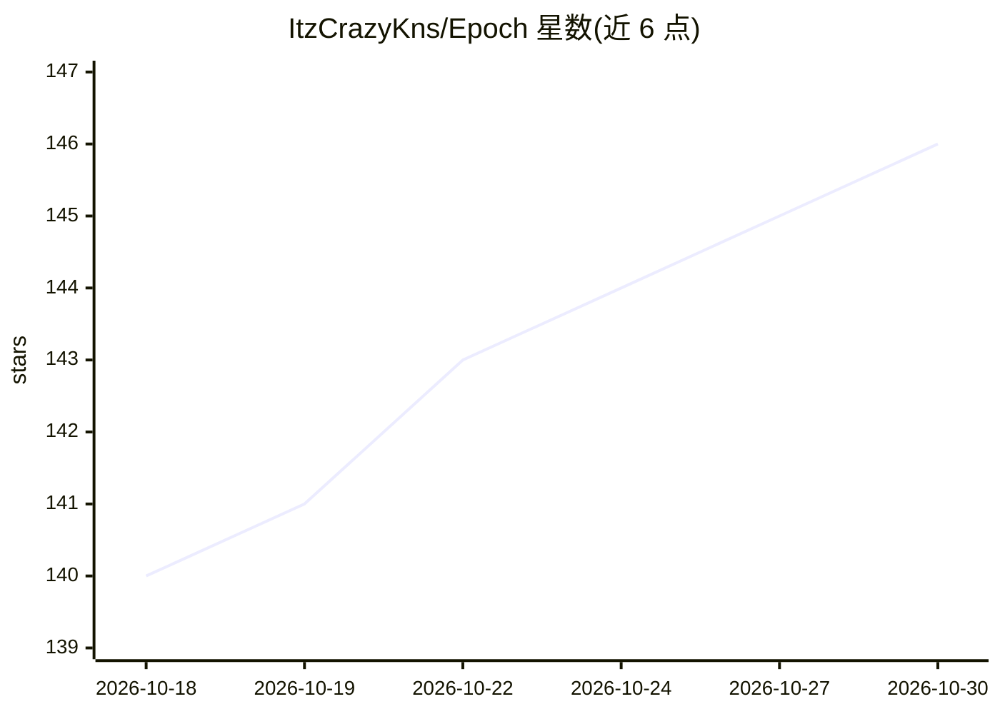

# ItzCrazyKns/Epoch

⭐ 146 · TypeScript · MIT · 推送 2025-11-16 · [GitHub](https://github.com/ItzCrazyKns/Epoch) · 个人维护

**将 LLM 回答渲染为可交互组件界面的 Web 聊天应用**

基于 Next.js/TypeScript 的 LLM 可视化对话界面：LLM 按递归 Zod schema 生成类型安全的组件树 JSON，客户端递归渲染为 25+ 种可交互 React 组件（图表、表单、按钮等）；用户操作（点击、表单提交）被序列化回对话历史，形成双向状态流与迭代式界面生成。支持 SSE 流式渐进渲染，内置 SearxNG/Serper 搜索集成，可配合 Ollama 本地模型离线运行或使用 OpenAI API。需 Node.js 18+，从源码 clone 构建。

## 筛选速览

| 维度 | 判定 | 备注 |
|---|---|---|
| AI 角色 | `ai-native` | 本体是模型或模型工具 |
| 许可风险 | `permissive` | MIT |
| 部署形态 | `library` | 以包/库形式分发 |
| 模型依赖 | local-ok | 支持本地模型 |
| 硬件要求 | — | 无带数字的原话,不猜 |
| 安装摩擦 | `low` | 无编译、无系统依赖或容器化 |
| 成熟度 | — | 结构信号不足 |

## 能力要点

- LLM 生成类型安全组件树，递归渲染为 25+ 种交互 React 组件
- 用户交互序列化回对话历史，支持跨轮次有状态界面再生成
- SSE 流式传输部分 JSON 并渐进渲染
- SearxNG/Serper 搜索集成，支持 Ollama 本地模型离线运行

## 适用场景

- 通过可点击的图表、表单和按钮与 LLM 回答交互
- 离线隐私场景下用 Ollama 运行本地模型获得可视化界面
- 在生成的界面中直接触发实时网页/图片搜索

## 场景标签

`聊天机器人` · 领域:对话与助手

## 证据(README 行号)

> L3: A **visual interface** for LLMs. Epoch transforms traditional text-based AI conversations into **interactive**, **co
> L11: Epoch eliminates this constraint through a structured component architecture. The LLM generates type-safe JSON sche
> L37: 2. **Structured Output Generation**: The backend invokes the LLM with a recursive Zod schema using `z.lazy()` for s

## 星数曲线

2026-10-18 140 → 2026-10-30 146（+6）

---
*卡片 v1 · prompt 1.4 · 生成 2026-10-22 · 置信度 high · 依据 README sha `7a67800da6be` · [字段定义](../../DATASET.md)*
