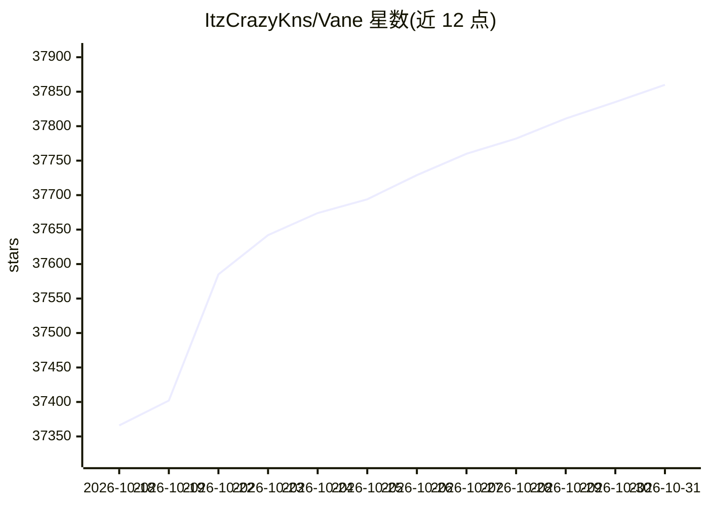

# ItzCrazyKns/Vane

⭐ 37,860 · TypeScript · MIT · 推送 2026-09-01 · [GitHub](https://github.com/ItzCrazyKns/Vane) · 个人维护

**自托管的 AI 答问搜索引擎，本地运行并带引用来源**

Vane 是一个注重隐私的 AI 答问引擎，可完全运行在用户自己的硬件上。它通过 SearxNG 聚合多个搜索引擎结果（支持网页、讨论、学术论文来源），接入本地 LLM（Ollama、OpenAI 兼容服务器、Lemonade）或云服务商（OpenAI、Claude、Groq、Gemini），生成带引用来源的回答。功能包括文件上传问答（PDF/文本/图片）、图片与视频搜索、域名限定搜索、天气/股价等小组件、搜索历史本地保存，并提供 API 供开发者集成。Docker 镜像内置 SearxNG，也支持 npm 从源码运行。

## 筛选速览

| 维度 | 判定 | 备注 |
|---|---|---|
| AI 角色 | `ai-native` | 本体是模型或模型工具 |
| 许可风险 | `permissive` | MIT |
| 部署形态 | `self-host` | docker 或自建部署 |
| 模型依赖 | local-ok | 支持本地模型 |
| 硬件要求 | — | 无带数字的原话,不猜 |
| 安装摩擦 | `low` | 无编译、无系统依赖或容器化 |
| 成熟度 | — | 结构信号不足 |

## 动量与使用信号

- 维护:`active` — 距上次 push 46.7 天,年发版 6,48 位贡献者
- 涨星:近 1 天 **+13**(自 20261016 起算)
- 平台:— · 协议:OLLAMA

## 能力要点

- 基于 SearxNG 的网页/讨论/学术搜索，回答带引用来源
- 支持本地 LLM（Ollama）与多家云服务商，可混合搭配模型
- 文件上传问答：PDF、文本、图片
- 提供 API 与浏览器搜索引擎快捷方式接入

## 适用场景

- 在自有硬件上自托管一个带引用来源的问答搜索引擎
- 用本地 LLM 保持搜索查询隐私
- 将搜索引擎集成到自己的应用中
- 把浏览器搜索栏切换为自托管 AI 搜索

## 场景标签

`语义搜索` `文档问答` · 领域:知识与检索

## 证据(README 行号)

> L11: Vane is a **privacy-focused AI answering engine** that runs entirely on your own hardware. It combines knowledge fr
> L19: 🤖 **Support for all major AI providers** - Use local LLMs through Ollama or connect to OpenAI, Anthropic Claude, Go
> L27: 🔍 **Web search powered by SearxNG** - Access multiple search engines while keeping your identity private. Support f

## 星数曲线

2026-10-18 37,366 → 2026-10-31 37,860（+494）

---
*卡片 v1 · prompt 1.4 · 生成 2026-10-18 · 置信度 high · 依据 README sha `a35e63bfb4d7` · [字段定义](../../DATASET.md)*
