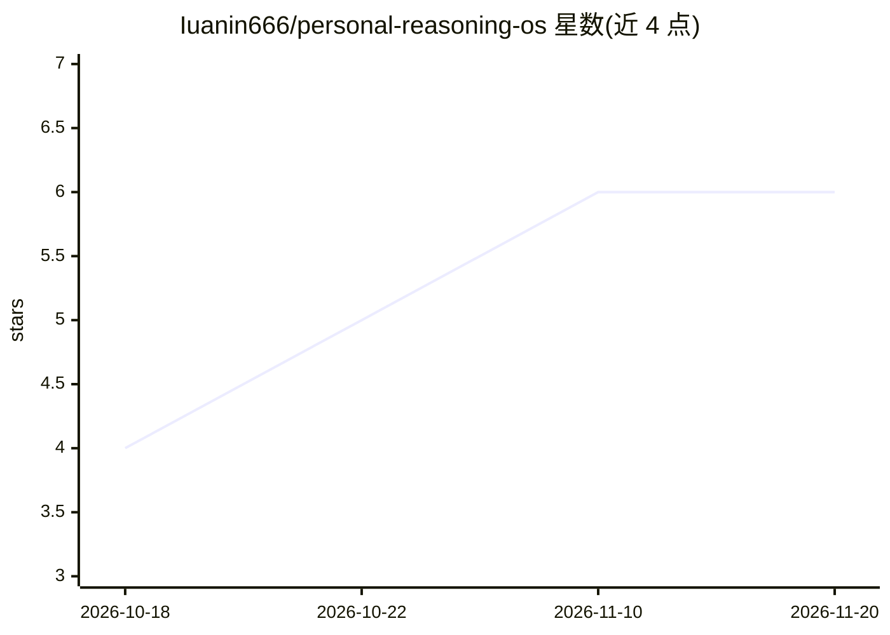

# Iuanin666/personal-reasoning-os

⭐ 6 · Python · MIT · 推送 2026-10-07 · [GitHub](https://github.com/Iuanin666/personal-reasoning-os) · 个人维护 · 中文 README

**个人本地化 Markdown 记忆与推理系统，面向长期使用 AI 的用户**

由三个部分组成：五个 Codex Agent Skill（$reflect/$ingest/$context/$analyze/$profile-review）、本地 Python 运行时（负责安全写入、导入、索引、检索与校验）、以及用户自有的 Markdown Vault。核心机制是把经历、决策、结果、档案分开存储，保留每条断言的来源类型（用户明示/AI 推断/外部来源），检索与分析只读，档案变更需用户确认。当前 v0.1.0，主要在 Windows + Codex 上测试，macOS/Linux 及其他客户端尚未正式测试。

## 筛选速览

| 维度 | 判定 | 备注 |
|---|---|---|
| AI 角色 | `ai-native` | 本体是模型或模型工具 |
| 许可风险 | `permissive` | MIT |
| 部署形态 | `None` |  |
| 模型依赖 | — | README 未给出锁定关系 |
| 硬件要求 | — | 无带数字的原话,不猜 |
| 安装摩擦 | `low` | 无编译、无系统依赖或容器化 |
| 成熟度 | `idea` | |

## 能力要点

- 五个 Skill 覆盖沉淀、导入、上下文检索、分析与档案回顾
- 来源可区分：用户明示、行为推断、AI 观察、外部来源不混写
- SQLite/全文索引/嵌入为可重建缓存，持久数据为 Markdown+YAML+Wikilinks
- AI 观察带置信度与反证据，档案变更需明确确认

## 适用场景

- 沉淀重要对话为结构化经历与决策记录
- 日后追溯当时为何这样选择、结果如何
- 导入论文/书籍作外部证据而不混入个人记忆
- 定期回顾自我认知的变化并确认是否提交档案变更

## 场景标签

`知识库管理` `Agent 记忆` · 领域:Agent 开发

## 证据(README 行号)

> L3: **A local-first, evidence-aware personal memory and reasoning system built on Markdown.**
> L13: It stores durable personal records in a Markdown vault that I own. Codex skills help me reflect on experiences, imp
> L69: 1. **Five Codex Agent Skills** that define when and how memory, retrieval, reasoning, and review happen.
> L136: `$analyze` supports perspective, analysis, advice, critique, and decision modes. It separates the user's evidence-

## 星数曲线

2026-10-18 4 → 2026-11-20 6（+2）

---
*卡片 v1 · prompt 1.4 · 生成 2026-11-20 · 置信度 high · 依据 README sha `adb607cd76d8` · [字段定义](../../DATASET.md)*
