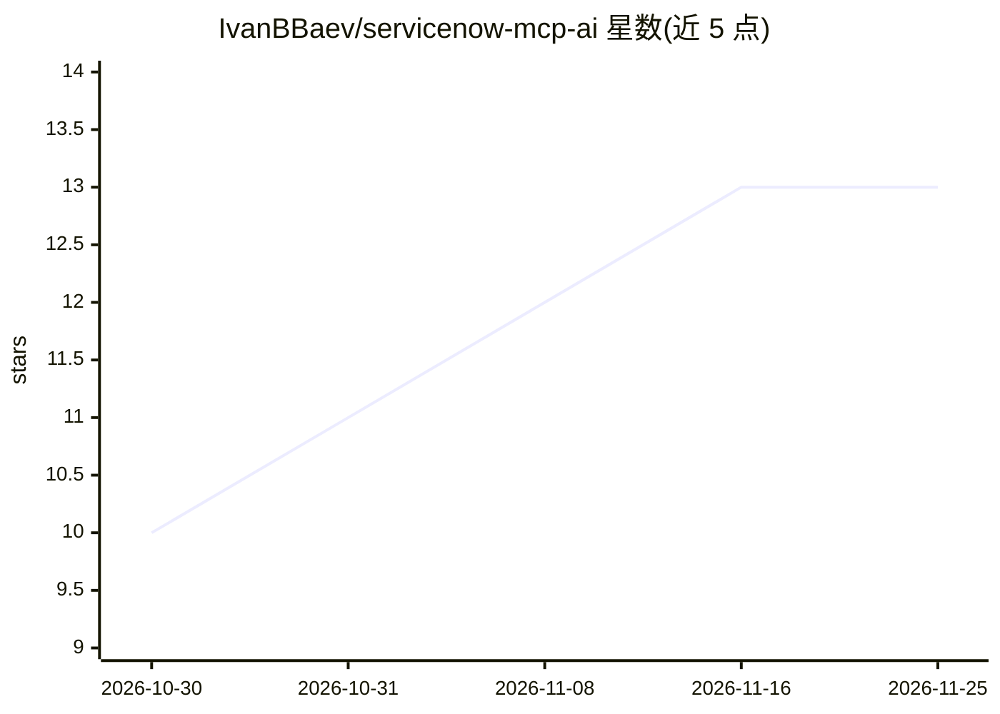

# IvanBBaev/servicenow-mcp-ai

⭐ 13 · JavaScript · GPL-3.0 · 推送 2026-11-13 · [GitHub](https://github.com/IvanBBaev/servicenow-mcp-ai) · [官网](https://ivanbbaev.github.io/servicenow-mcp-ai/)

**连接 MCP 客户端与 ServiceNow 实例的 MCP 服务器，提供安全 AI 写入**

一个 MCP 服务器，通过 ServiceNow REST API 将 Claude Desktop、Claude Code、VS Code Copilot Chat、Cursor 等 MCP 客户端连接到 ServiceNow 实例。每次写入先预览，破坏性操作需一次性 plan token，记录写入进入日志并可回退；同时提供字段使用查找、保存时执行链追踪、实例间漂移对比等代码智能功能。共 100 个工具分 28 个包，默认加载 20 个，通过 SN_TOOL_PACKAGES 控制其余；凭证保存在本地 env 文件，支持 Basic 与 OAuth 2.0 认证。

## 筛选速览

| 维度 | 判定 | 备注 |
|---|---|---|
| AI 角色 | `ai-ecosystem` | LLM/agent 周边工具 |
| 许可风险 | `viral` | GPL-3.0 |
| 部署形态 | `self-host` | docker 或自建部署 |
| 模型依赖 | — | README 未给出锁定关系 |
| 硬件要求 | — | 无带数字的原话,不猜 |
| 安装摩擦 | `low` | 无编译、无系统依赖或容器化 |
| 成熟度 | — | 结构信号不足 |

## 能力要点

- 写入预览、破坏性操作单次 plan token、本地日志与回退机制
- 100 个工具分 28 个包，默认加载 20 个以控制 token 占用
- find usages、保存链追踪、dev/prod 漂移 diff（带 CI 退出码）
- 支持 VS Code、Claude Code/Desktop、Cursor 等 11 种客户端配置

## 适用场景

- 通过对话让 AI 助手安全地管理 ServiceNow 工单与 CMDB 记录
- 在 CI 流水线中检测 dev 与 prod 实例间的配置漂移并阻断部署
- 查找 ServiceNow 字段/脚本被哪些业务规则、ACL 引用

## 场景标签

 · 领域:MCP 服务器/ITSM 集成

## 证据(README 行号)

> L10: **Safe AI writes for ServiceNow.** An MCP server that connects any MCP client — Claude Desktop, Claude Code, VS Cod
> L13: 100 tools in 28 packages: 20 load by default and SN_TOOL_PACKAGES adds the rest, so the tool list stays small in to
> L15: Its tools cover the Table, Aggregate, Attachment, Import Set, Batch and CMDB APIs,

## 星数曲线

2026-10-30 10 → 2026-11-25 13（+3）

---
*卡片 v1 · prompt 1.4 · 生成 2026-11-18 · 置信度 mid · 依据 README sha `fd7d210c3e7f` · [字段定义](../../DATASET.md)*
