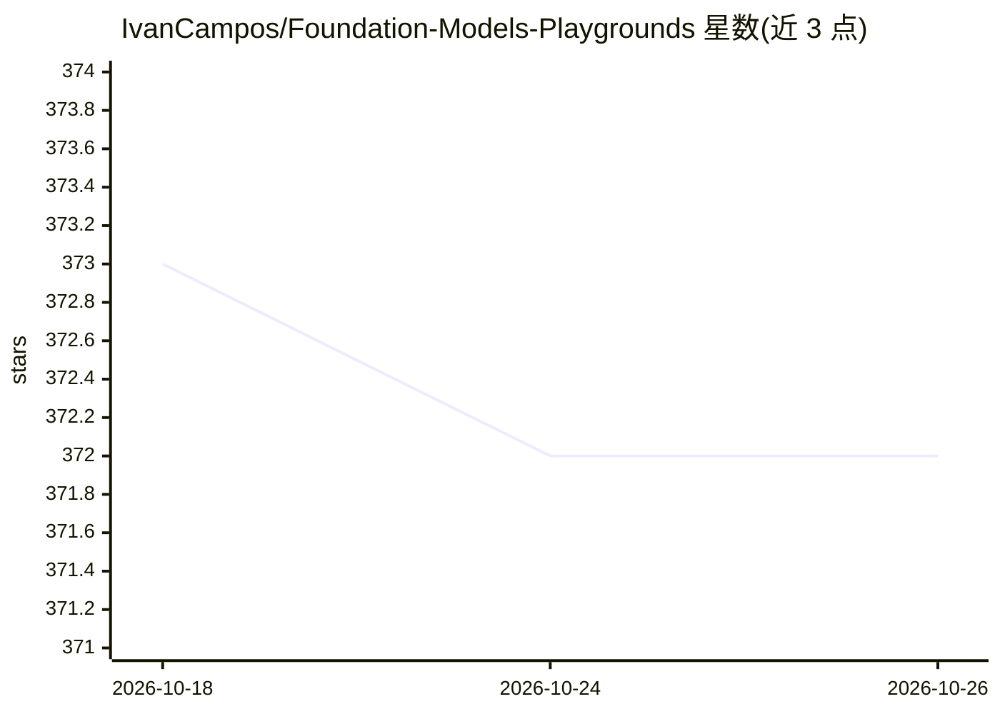

# IvanCampos/Foundation-Models-Playgrounds

⭐ 372 · Swift · 推送 2025-12-20 · [GitHub](https://github.com/IvanCampos/Foundation-Models-Playgrounds) · [官网](https://ivancampos.com) · 个人维护

**Apple Foundation Models 框架的 Swift Playground 示例集（145 个）**

面向 Apple 平台开发者的 Swift Playground 示例合集，演示如何调用系统内置的 Foundation Models 框架：覆盖对话、摘要、代码辅助、翻译、工具调用、安全护栏、Agent 模式（ReAct/Plan-Execute/ReWOO 等）共 145 个示例，每个示例展示一项生成能力或 API 用法，包括 @Generable 结构化输出、流式 token、guardrails 与上下文窗口管理（TN3193）。推理在设备端完成，无需 API key。以 Swift 源码 playground 形式提供，需在 Xcode/Swift Playgrounds 环境运行。

## 筛选速览

| 维度 | 判定 | 备注 |
|---|---|---|
| AI 角色 | `ai-knowledge` | 知识聚合/清单类 |
| 许可风险 | `none` | — |
| 部署形态 | `None` |  |
| 模型依赖 | — | README 未给出锁定关系 |
| 硬件要求 | — | 无带数字的原话,不猜 |
| 安装摩擦 | `low` | 无编译、无系统依赖或容器化 |
| 成熟度 | — | 结构信号不足 |

## 能力要点

- 145 个 Swift Playground 示例，按对话/摘要/代码/翻译/工具/安全/Agent 模式等分类
- 覆盖 @Generable & @Guide 结构化输出、流式 token、工具调用
- 含 ReAct、Plan-Execute、ReWOO、多智能体等 Agent 模式实现示例
- 设备端推理，无需 API key，可离线运行

## 适用场景

- 学习 Apple Foundation Models 框架的各项 API 与能力
- 查找结构化输出、工具调用、安全护栏的参考实现
- 在 iOS/macOS/visionOS 应用中集成端侧模型前做原型验证

## 场景标签

`教程课程` · 领域:学习与行业

## 证据(README 行号)

> L3: This repository contains a collection of Swift playgrounds demonstrating how to interact with Apple's Foundation Mod
> L184: ##  Developer Docs

## 星数曲线

2026-10-18 373 → 2026-10-26 372（-1）

---
*卡片 v1 · prompt 1.4 · 生成 2026-10-22 · 置信度 high · 依据 README sha `ac8e3c63d0c6` · [字段定义](../../DATASET.md)*
