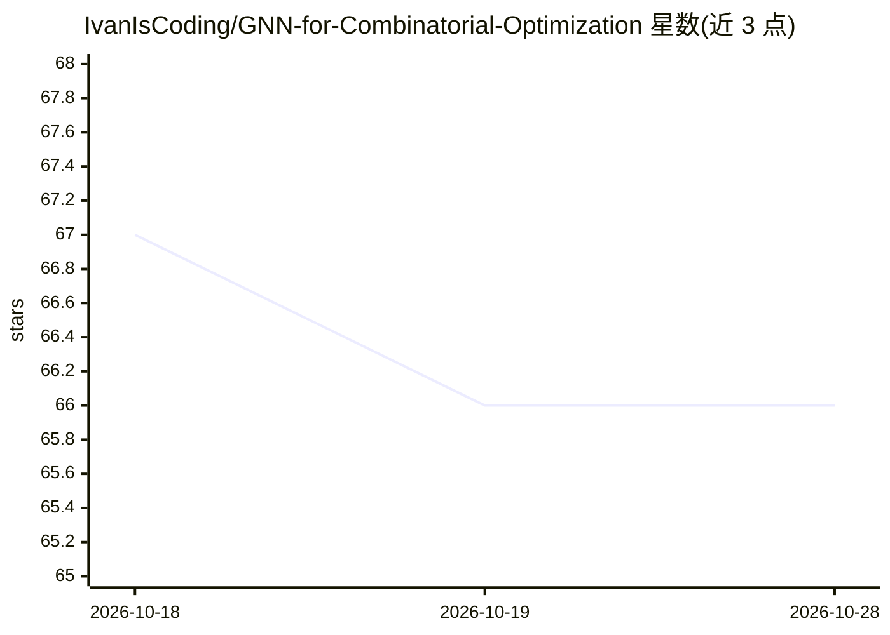

# IvanIsCoding/GNN-for-Combinatorial-Optimization

⭐ 66 · Jupyter Notebook · MIT · 推送 2025-11-09 · [GitHub](https://github.com/IvanIsCoding/GNN-for-Combinatorial-Optimization) · 个人维护

**用 JAX+Flax 复现物理启发 GNN 求解组合优化的笔记本教程**

一系列 Jupyter Notebook，基于 Schuetz 等人的论文《Combinatorial Optimization with Physics-Inspired Graph Neural Networks》用 JAX + Flax + PyQUBO 实现 GNN 架构，在最大 2000 节点的 d-regular 图上求解 Max-Cut 与最大独立集问题，并与 OpenJij 模拟退火采样器对比结果；还讨论了 Boettcher 与 Angelini 等人对原论文基线的质疑。代码经 nbdev 导出为 Python 库 gnn_for_co，可通过 pip 从 GitHub 安装，Notebook 支持 Colab/nbviewer 打开。

## 筛选速览

| 维度 | 判定 | 备注 |
|---|---|---|
| AI 角色 | `ai-native` | 本体是模型或模型工具 |
| 许可风险 | `permissive` | MIT |
| 部署形态 | `library` | 以包/库形式分发 |
| 模型依赖 | — | README 未给出锁定关系 |
| 硬件要求 | — | 无带数字的原话,不猜 |
| 安装摩擦 | `low` | 无编译、无系统依赖或容器化 |
| 成熟度 | — | 结构信号不足 |

## 能力要点

- JAX + Flax + PyQUBO 实现 GNN 架构并复现论文部分结果
- 求解规模至 2000 节点 d-regular 图上的 Max-Cut 与 MIS
- 与 OpenJij 模拟退火（SASampler）对比并讨论论文争议
- nbdev 导出为可 pip 安装的 gnn_for_co 包

## 适用场景

- 学习如何用 JAX/Flax 实现求解组合优化问题的 GNN
- 复现并检验 Schuetz et al. 论文的结果与争议
- 对比 GNN 启发式与模拟退火在 Max-Cut/MIS 上的表现

## 场景标签

`教程课程` · 领域:学习与行业

## 证据(README 行号)

> L11: We will implement the proposed architecture for the GNN using JAX + Flax and then replicate some results from the p
> L22:     ├── 00_GNN_Definition.ipynb            # Defines the GNN using JAX + Flax and PyQUBO

## 星数曲线

2026-10-18 67 → 2026-10-28 66（-1）

---
*卡片 v1 · prompt 1.4 · 生成 2026-10-24 · 置信度 mid · 依据 README sha `959fa916e387` · [字段定义](../../DATASET.md)*
