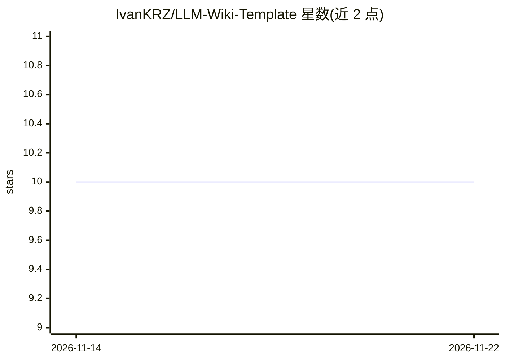

# IvanKRZ/LLM-Wiki-Template

⭐ 10 · 推送 2026-04-19 · [GitHub](https://github.com/IvanKRZ/LLM-Wiki-Template) · 个人维护 · 中文 README

**Obsidian+Claude Code 的知识库 Wiki 模板，代替传统 RAG**

基于 Karpathy llm-wiki 思路的模板：把知识库当代码库管理，Claude Code agent 作为维护者，将 raw/ 中的原始文档编译为交叉链接、带精确引用的 Obsidian Wiki。提供 /bootstrap、/ingest、/query、/lint 等斜杠命令，采用 human-in-the-loop 设计，agent 不写 raw/、不自动修复、不擅自归档。依赖 Obsidian v1.12+ 与 Claude Code，规模上限约 200 源/500 页，超出需迁移至 qmd 或 GraphRAG。MIT 许可，README 含英德双语版本。

## 筛选速览

| 维度 | 判定 | 备注 |
|---|---|---|
| AI 角色 | `ai-knowledge` | 知识聚合/清单类 |
| 许可风险 | `none` | — |
| 部署形态 | `None` |  |
| 模型依赖 | locked-api |  |
| 硬件要求 | — | 无带数字的原话,不猜 |
| 安装摩擦 | `low` | 无编译、无系统依赖或容器化 |
| 成熟度 | — | 结构信号不足 |

## 能力要点

- /bootstrap /ingest /query /lint /search /reindex 等斜杠命令操作集
- 每次摄入扇出为 Entity、Concept、Source 摘要页并交叉链接
- 精确 wikilink 引用与矛盾检测/标记
- human-in-the-loop：agent 不写 raw/、不自动修复 lint

## 适用场景

- 把个人 Obsidian 笔记整理为机器可读、带引用的知识库
- 用 agent 问答代替传统 RAG 检索流程
- 批量摄入资料后检测知识库中的矛盾与断链

## 场景标签

`知识库管理` · 领域:知识与检索

## 证据(README 行号)

> L3: > A Karpathy-style persistent knowledge artifact — compiled once, kept current, machine-readable by design.
> L17: The core idea: **treat your knowledge base like a codebase.** The agent is the programmer, the wiki is the compiled
> L70: - Claude Code (current version)

## 星数曲线

2026-11-14 10 → 2026-11-22 10（+0）

---
*卡片 v1 · prompt 1.4 · 生成 2026-11-20 · 置信度 high · 依据 README sha `932bc9009c29` · [字段定义](../../DATASET.md)*
