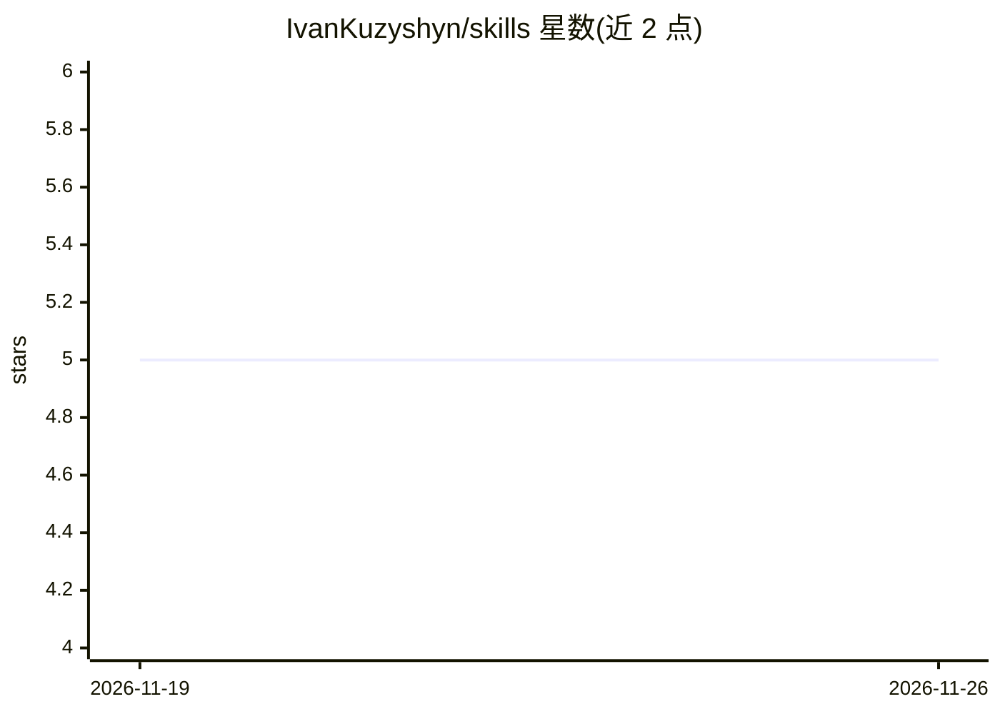

# IvanKuzyshyn/skills

⭐ 5 · Go · MIT · 推送 2026-11-21 · [GitHub](https://github.com/IvanKuzyshyn/skills) · 个人维护

**个人日常沉淀的开放格式 Agent 技能集，供各 Agent CLI 安装**

以开放 Agent Skills 格式组织的技能仓库，技能存放在 skills/<name>/ 目录下，目前收录 twelve-factor-app 技能（按 Twelve-Factor App 方法论设计服务或评估现有代码库，附违规信号与模式）。提供面向 Claude Code、Codex、GitHub Copilot CLI、VS Code、Gemini CLI 的插件市场安装命令，以及经 skills.sh 面向任意 agent 的 npx 安装途径；版本由 Changesets 统一管理，单一 semver 覆盖插件与全部技能。

## 筛选速览

| 维度 | 判定 | 备注 |
|---|---|---|
| AI 角色 | `ai-knowledge` | 知识聚合/清单类 |
| 许可风险 | `permissive` | MIT |
| 部署形态 | `library` | 以包/库形式分发 |
| 模型依赖 | — | README 未给出锁定关系 |
| 硬件要求 | — | 无带数字的原话,不猜 |
| 安装摩擦 | `low` | 无编译、无系统依赖或容器化 |
| 成熟度 | — | 结构信号不足 |

## 能力要点

- 技能采用开放 Agent Skills 格式，按 skills/<name>/ 目录组织
- 支持 Claude Code、Codex、GitHub Copilot CLI、Gemini CLI 等 5 种安装途径
- twelve-factor-app 技能含违规信号与模式，用于代码库评估
- 单一 semver 版本管理插件与全部技能（Changesets）

## 适用场景

- 在 Claude Code 或 Codex 中安装 Twelve-Factor 方法论评估技能
- 用技能对现有代码库做 Twelve-Factor 合规检查
- 通过 skills.sh 给其他 agent 按需安装单个技能

## 场景标签

`编码 Agent` `代码审查` · 领域:编码与开发

## 证据(README 行号)

> L3: Agent skills in the open Agent Skills format. Each skill lives in `skills/<name>/`.
> L44: ### Any other agent (skills.sh)

## 星数曲线

2026-11-19 5 → 2026-11-26 5（+0）

---
*卡片 v1 · prompt 1.4 · 生成 2026-11-21 · 置信度 high · 依据 README sha `c727f1aae9ec` · [字段定义](../../DATASET.md)*
