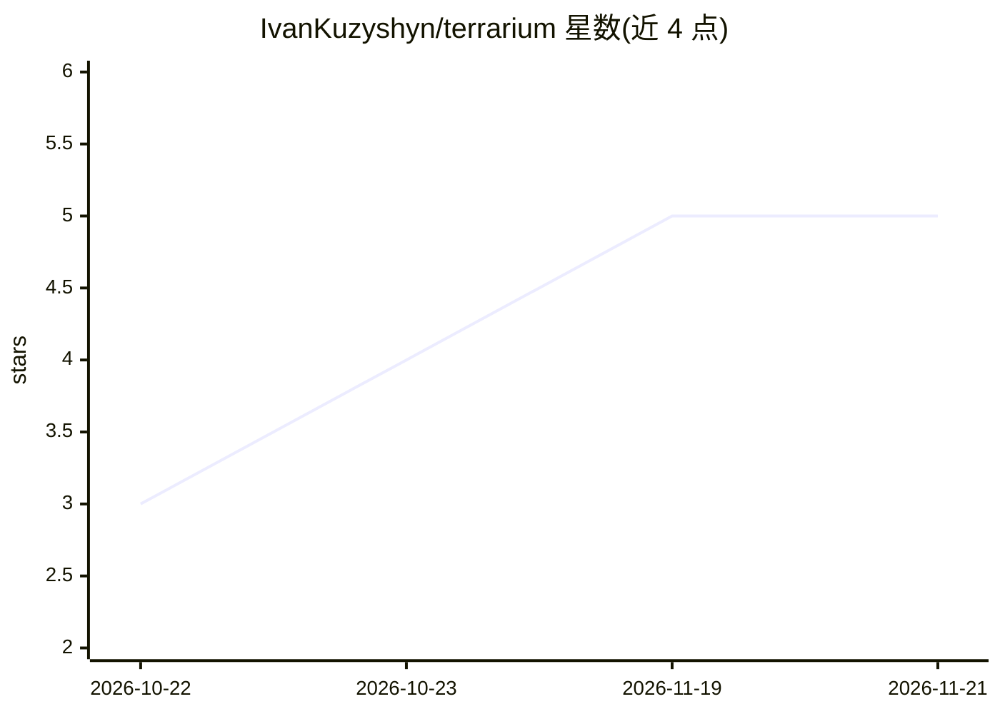

# IvanKuzyshyn/terrarium

⭐ 5 · Go · MIT · 推送 2026-10-17 · [GitHub](https://github.com/IvanKuzyshyn/terrarium) · 个人维护

**学习用远程 coding-agent 平台原型：在隔离沙箱中运行 Claude Code/Codex**

单机原型平台，演示远程 coding-agent 会话的关键构件：一次性 Docker 沙箱（受控网络出口）、凭据置换网关（真实凭据不进入沙箱）、会话生命周期管理（供应、监控、超时、清理与故障恢复）、多 harness 适配（Claude Code 与 Codex 共用平台）。通过 HTTP API、MCP 与 Web UI 启动会话、发送后续提示并查看实时流。依赖 macOS、Docker Desktop 与 mise，会话使用用户自有的 Claude 或 ChatGPT 订阅，明确声明仅供学习与演示、不可用于生产。

## 筛选速览

| 维度 | 判定 | 备注 |
|---|---|---|
| AI 角色 | `ai-ecosystem` | LLM/agent 周边工具 |
| 许可风险 | `permissive` | MIT |
| 部署形态 | `self-host` | docker 或自建部署 |
| 模型依赖 | — | README 未给出锁定关系 |
| 硬件要求 | — | 无带数字的原话,不猜 |
| 安装摩擦 | `low` | 无编译、无系统依赖或容器化 |
| 成熟度 | `idea` | |

## 能力要点

- 一次性 Docker 沙箱运行 agent，凭据经网关置换、不进入沙箱
- Claude Code 与 Codex 双 harness，通过适配器接入统一平台
- HTTP API、MCP server 与 Web UI 三种交互方式
- 内置十个可运行示例场景（禁止出口、提示注入陷阱、草稿 PR 等）

## 适用场景

- 学习远程 coding-agent 平台的架构设计与取舍
- 在隔离沙箱中试用 Claude Code 或 Codex 而不暴露凭据
- 通过 MCP 让其他 agent 创建和管理沙箱内的编码会话
- 按威胁模型文档研究沙箱出口控制与权限预设

## 场景标签

 · 领域:开发者工具/agent 基础设施

## 证据(README 行号)

> L8: - **Isolated sandboxes:** run agents in disposable Docker environments with controlled network access.
> L13: - **Multi-harness support:** run Claude Code and Codex through a shared platform with harness-specific
> L28: A single-machine prototype of an internal platform for remote coding-agent sessions. An engineer

## 星数曲线

2026-10-22 3 → 2026-11-21 5（+2）

---
*卡片 v1 · prompt 1.4 · 生成 2026-11-21 · 置信度 mid · 依据 README sha `72b091497a3a` · [字段定义](../../DATASET.md)*
