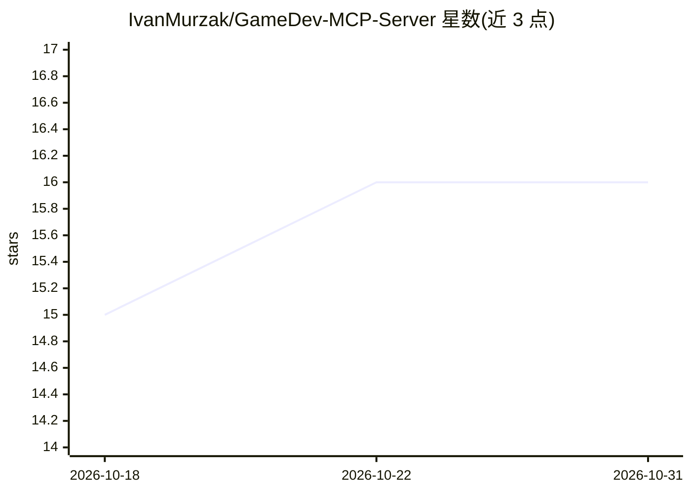

# IvanMurzak/GameDev-MCP-Server

⭐ 16 · C# · Apache-2.0 · 推送 2026-10-30 · [GitHub](https://github.com/IvanMurzak/GameDev-MCP-Server) · [官网](https://ai-game.dev) · 个人维护

**跨游戏引擎的本地 MCP 服务器：桥接 AI 客户端与 Unity/Godot/Unreal 插件**

引擎无关的 Model Context Protocol 服务器，作为薄宿主承载 NuGet 包 McpPlugin.Server 与 ReflectorNet 的逻辑，通过 SignalR 将 MCP 客户端（Claude、Cursor、Copilot 等）与 Unity/Godot/Unreal 的编辑器插件连接起来；本仓库不含引擎特定代码，工具、资源与提示由所连插件动态提供。提供 7 种平台的预编译可执行文件、Docker 镜像、dotnet tool 与源码构建四种安装方式，支持 stdio/streamableHttp 两种传输与 OAuth 2.1 资源服务器模式，并可一键为各类 AI agent 写入 MCP 客户端配置。

## 筛选速览

| 维度 | 判定 | 备注 |
|---|---|---|
| AI 角色 | `ai-ecosystem` | LLM/agent 周边工具 |
| 许可风险 | `permissive` | Apache-2.0 |
| 部署形态 | `self-host` | docker 或自建部署 |
| 模型依赖 | — | README 未给出锁定关系 |
| 硬件要求 | — | 无带数字的原话,不猜 |
| 安装摩擦 | `low` | 无编译、无系统依赖或容器化 |
| 成熟度 | — | 结构信号不足 |

## 能力要点

- 一个服务器二进制服务 Unity/Godot/Unreal 三类引擎插件，经 SignalR 桥接
- 提供 win/linux/osx 共 7 个 RID 的预编译可执行文件、Docker 镜像与 dotnet tool
- OAuth 2.1 资源服务器模式（ES256 JWT + JWKS），stdio 默认零配置无认证
- configure 命令按项目生成 MCP 客户端配置，凭据不写入项目文件

## 适用场景

- 在 Claude/Cursor/Copilot 等 AI 客户端中操作 Unity/Godot/Unreal 编辑器
- 多引擎开发团队用同一本地 MCP 服务器连接各引擎插件
- 托管部署时通过 OAuth 与反向代理对外提供 MCP 服务

## 场景标签

 · 领域:游戏开发/AI 工具接入

## 证据(README 行号)

> L29: Engine-agnostic Model Context Protocol server shared by the game-engine MCP plugins:
> L37: It is a thin host over the NuGet packages `com.IvanMurzak.McpPlugin.Server` and `com.IvanMurzak.ReflectorNet`, wher
> L40: MCP client  ⇄  gamedev-mcp-server  ⇄ (SignalR) ⇄  engine plugin (Unity / Godot / Unreal)

## 星数曲线

2026-10-18 15 → 2026-10-31 16（+1）

---
*卡片 v1 · prompt 1.4 · 生成 2026-10-30 · 置信度 high · 依据 README sha `1c9df8b168c0` · [字段定义](../../DATASET.md)*
