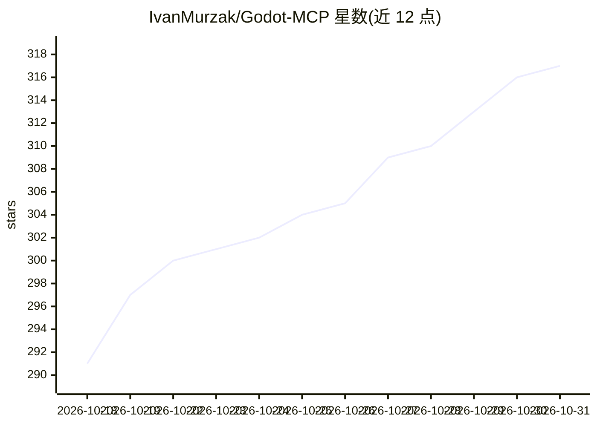

# IvanMurzak/Godot-MCP

⭐ 317 · C# · Apache-2.0 · 推送 2026-10-30 · [GitHub](https://github.com/IvanMurzak/Godot-MCP) · [官网](https://ai-game.dev) · 个人维护

**Godot 编辑器的 MCP 集成插件：让 AI 代理直接操作 Godot 项目**

面向 Godot Editor 的 C# 编辑器插件，将编辑器操作封装为 23 个 MCP 工具（9 个族），供 Claude、Cursor、Copilot 等 MCP 感知代理调用：通过 RQL 查询/修改场景树与属性、CRUD 管理 C#/GDScript 脚本、截图供 LLM 检视、在运行中的游戏里反射调用 C# 方法并捕获运行时错误。默认连接 ai-game.dev 云后端，也可指向自建服务器；通过 godot-cli（npm 安装）完成部署。要求 Godot 4.3+ 的 mono/.NET 版本与 .NET 8 SDK；与 Unity-MCP 共用同一 MCP/reflection 技术栈（以 NuGet 包引用）。

## 筛选速览

| 维度 | 判定 | 备注 |
|---|---|---|
| AI 角色 | `ai-ecosystem` | LLM/agent 周边工具 |
| 许可风险 | `permissive` | Apache-2.0 |
| 部署形态 | `desktop` | 安装包/桌面程序 |
| 模型依赖 | — | README 未给出锁定关系 |
| 硬件要求 | — | 无带数字的原话,不猜 |
| 安装摩擦 | `medium` | 含编译或系统依赖之一 |
| 成熟度 | — | 结构信号不足 |

## 能力要点

- 23 个内置 MCP 工具，分 9 个族，覆盖场景/脚本/截图/运行时
- RQL 统一查询语言操作整个编辑器，编辑可撤销、all-or-nothing
- 支持云（ai-game.dev）或自建服务器两种连接方式
- godot-cli 一条命令安装，免手动复制文件与改 csproj

## 适用场景

- 让 Claude/Cursor/Copilot 等 AI 代理直接创建节点、编辑场景与脚本
- 在对话中让 AI 操作 Godot 编辑器完成游戏开发任务
- AI 通过截图检查视口与节点渲染结果
- 捕获并轮询运行中游戏的运行时错误供 AI 排查

## 场景标签

`编码 Agent` · 领域:编码与开发

## 证据(README 行号)

> L31: `Godot MCP` is an AI-powered game development assistant **for the Godot Editor**. Connect **Claude**, **Cursor**, *
> L33: Godot-MCP is the Godot counterpart of Unity-MCP: a C# **editor addon** that exposes Godot Editor operations as **AI
> L40: - ✔️ **23 built-in Tools** — MCP Tools across 9 families for operating the Godot Editor, led by RQL: one query lang

## 星数曲线

2026-10-18 291 → 2026-10-31 317（+26）

---
*卡片 v1 · prompt 1.4 · 生成 2026-10-21 · 置信度 high · 依据 README sha `a83da38505fe` · [字段定义](../../DATASET.md)*
